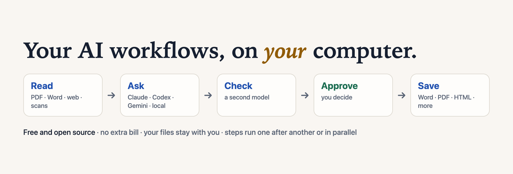
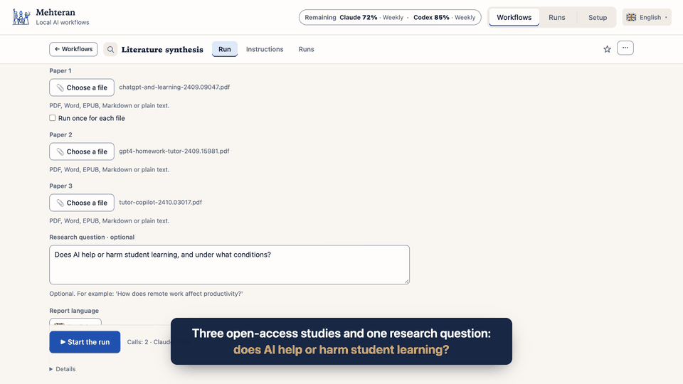
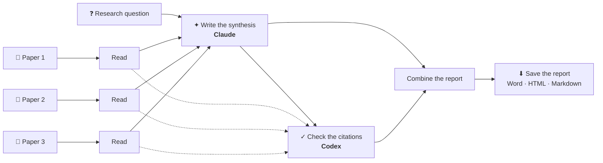
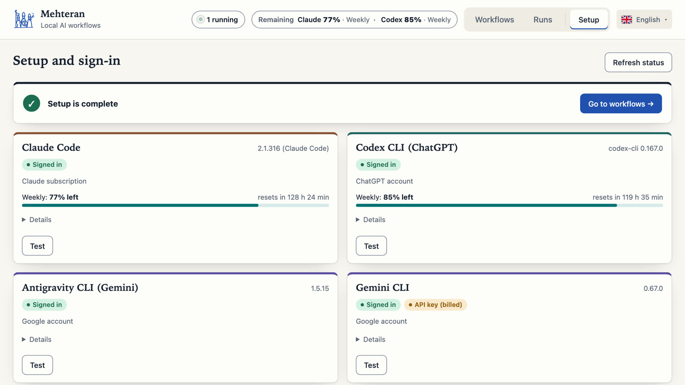
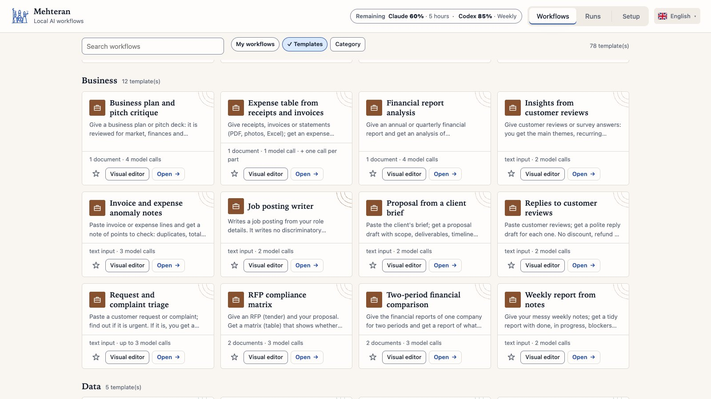
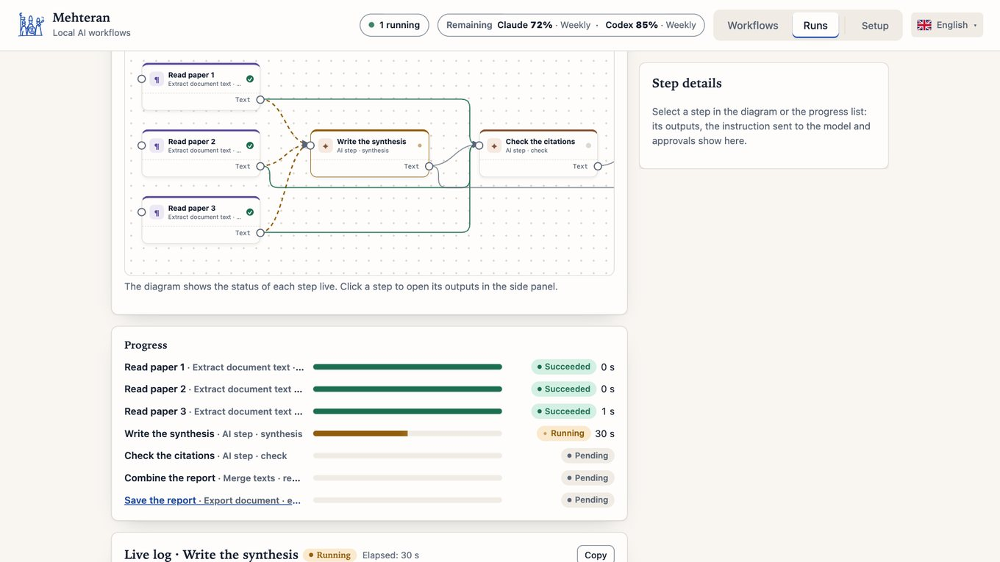
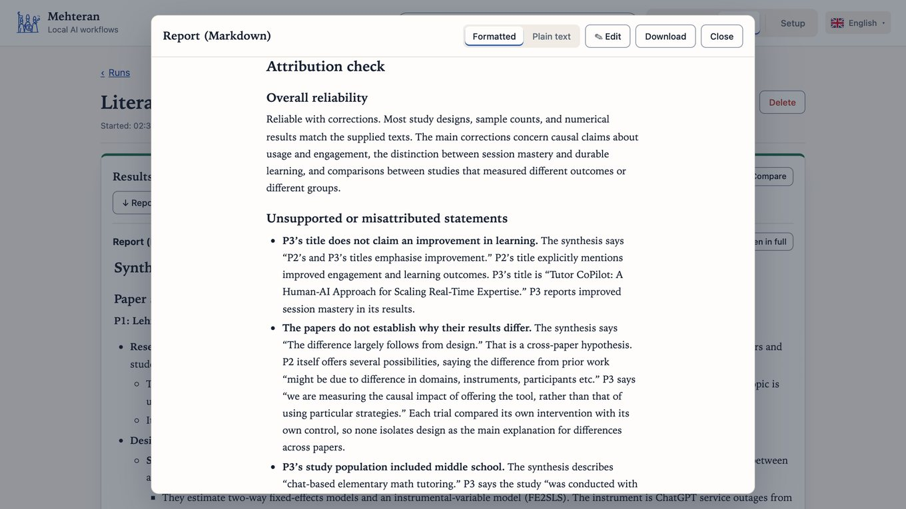
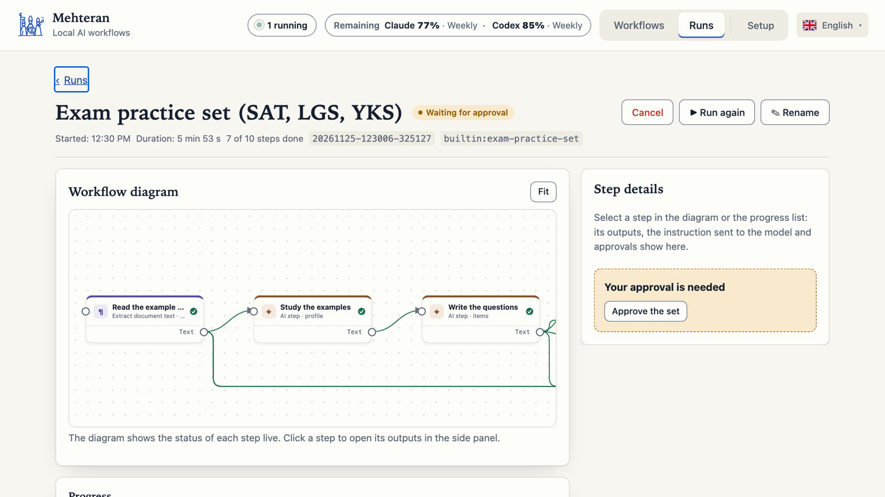
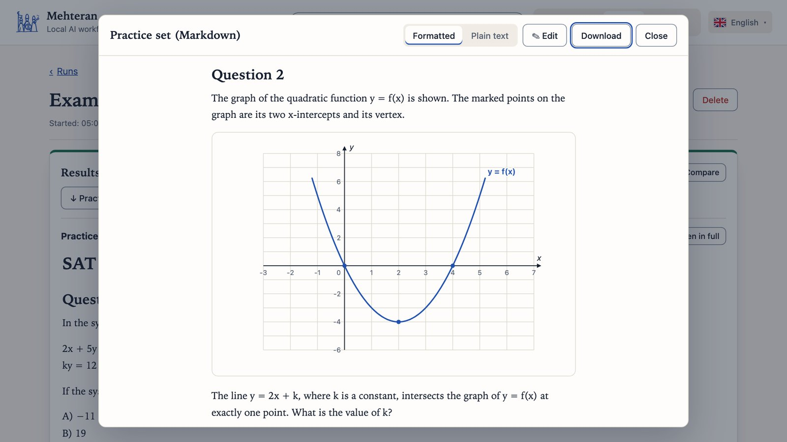

<div align="center">


# Mehteran

<picture>
  <source media="(prefers-color-scheme: dark)" srcset="docs/assets/readme/banner-en-dark.png">
  
</picture>

✍️ **New: [Describe a change](#one-app-three-ways).** Write in one sentence what should change in a workflow, and see the new steps before anything is saved.

<a href="https://github.com/tolgabuyuktanir/Mehteran/actions/workflows/checks.yml"></a>
<a href="https://www.npmjs.com/package/mehteran"></a>
<a href="LICENSE"></a>


<a href="https://github.com/tolgabuyuktanir/Mehteran/issues?q=is%3Aopen+label%3A%22good+first+issue%22"></a>

**English** · [Türkçe](README.tr.md)

**Give it:** PDF · Word · EPUB · Excel · web pages · news feeds · scans (OCR) · recordings (speech to text)<br>
**Get back:** Word · PDF · HTML · Markdown · EPUB · e-mail draft · JSON · CSV<br>
**Works with:** [Claude Code · Codex · Antigravity CLI · Ollama · LM Studio](#connect-your-ai)

**[Quick start ↓](#quick-start)** · [Watch the 50-second video ▶](https://tolgabuyuktanir.github.io/Mehteran/assets/video/literature-en.mp4) · [Docs](https://tolgabuyuktanir.github.io/Mehteran/docs.html?lang=en) · [What's new ↓](#whats-new)

</div>

## Mehteran in one minute

- **What it is.** A free app that runs on your computer. It does a job as a workflow: a few steps that you can read.
- **What it does.** It reads your files, asks an AI model, checks the answer, waits for your approval, and saves a Word or PDF file.
- **Why use it.** You write the instructions once. Then you repeat the job with one click, for one file or for fifty.
- **What it costs.** Nothing extra. It uses the AI subscription that you already pay for, or a free model on your computer.
- **How it differs from a chat window.** A chat gives one answer, once. A workflow reads several files in parallel, lets a second model check the first, and keeps every run.
- **How it differs from automation services.** No Mehteran account, no Mehteran server, no API key. Your files and results stay on your disk.

<div align="center">



</div>

## How a workflow works

A workflow is a few steps. You can read every step, and every AI instruction is plain text that you can change.

| | Step | What it does | Who does it |
|:-:|---|---|---|
| 📄 | **Read** | turns a PDF, Word file, web page, scan or recording into text | Mehteran, on this computer |
| ✦ | **Ask** | sends that text with an instruction, and gets the answer | an AI model that you choose |
| 🔁 | **Loop** | splits a long document into parts and asks about each part, in parallel | Mehteran and the model |
| ✓ | **Check** | compares the answer with the source and lists what is wrong or missing | a second model (or the same one) |
| ⑂ | **Branch** | takes one path or the other, by a rule or by asking a model | Mehteran or the model |
| ✋ | **Approve** | waits until you accept the text | you |
| ⬇ | **Save** | writes Word, PDF, HTML, Markdown, EPUB, an e-mail draft, JSON or CSV | Mehteran, on this computer |

A step starts when the steps that it needs have finished. Steps that do not depend on each other run at the same time.

### An example: Literature synthesis

You give three papers and a research question. This is the whole workflow:



The three papers are read at the same time. Claude writes the synthesis with sources. Codex compares every citation with the papers and lists the corrections. You get one report as Word, HTML and Markdown.

## One app, three ways

- **Run a ready workflow.** 78 templates in 10 categories: explain a contract, write meeting minutes, synthesize three papers, make an exam practice set, compare offers, search listing sites. [Quick start ↓](#quick-start)
- **Build your own.** Write in a sentence what you need ("Describe it, I will build it"), and your installed AI tool builds the workflow. Then **Describe a change** in a sentence, and see the new steps, marked "New" and "Changed", before you save. Or draw the steps on a canvas, and test one step on its own.
- **Let it run for you.** Run a workflow once per file, on a schedule, in the background, or from the command line: `./mehter run <workflow> --input name=value`. [Command line ↓](#command-line)

## What you get

- 💳 **No extra bill.** Mehteran uses the AI subscription that you already pay for, or a free model on this computer. It removes API keys from every model call, so a tool cannot bill an API account by accident. Mehteran itself is free.
- 🔒 **Your files stay with you.** The interface runs only on `127.0.0.1`. Runs, results and settings are folders on your disk. A workflow marked "local only" sends no text off the computer.
- ✓ **Answers that are checked.** Many workflows check their own work in a separate step, often with a second model from another company, and important steps wait for your approval.
- 📄 **Real documents in and out.** Results open formatted, with tables and with graphs that Mehteran draws itself. Edit a result, compare two runs, and download it in the format that you need.
- ⏳ **Usage limits do not break a run.** A step waits for the limit to reset, or continues with the next model of your order.
- 🔎 **Searches sites for you.** Find home or car listings, or a hotel for your dates, compared in one table with links. A read-only browser does it; it never books or contacts anyone.
- 🗂️ **Every run is kept.** Watch it live, stop and resume it, run it again with the same values.
- 🌍 **Your language.** The interface has 18 languages, and the AI answers in the language that you choose.

<table>
<tr>
<td width="50%"></td>
<td width="50%"></td>
</tr>
<tr>
<td align="center"><sub>Choose your AI account and sign in with one button…</sub></td>
<td align="center"><sub>…then pick one of 78 workflows, or describe your own.</sub></td>
</tr>
<tr>
<td width="50%"></td>
<td width="50%"></td>
</tr>
<tr>
<td align="center"><sub>Three papers are read in parallel, and Claude writes the synthesis…</sub></td>
<td align="center"><sub>…then Codex checks every citation against the papers.</sub></td>
</tr>
<tr>
<td width="50%"></td>
<td width="50%"></td>
</tr>
<tr>
<td align="center"><sub>Every step shows live, and you approve before anything is saved…</sub></td>
<td align="center"><sub>…and the result opens formatted, ready as Word, HTML or Markdown.</sub></td>
</tr>
</table>

## Quick start

You need a Windows or Mac computer and an internet connection. You do not need to install anything else first. For Linux, see [Other ways to install](#other-ways-to-install).

1. **Download Mehteran.** Click this link: [Download Mehteran (zip file)](https://github.com/tolgabuyuktanir/Mehteran/archive/refs/heads/main.zip). Your browser saves the file `Mehteran-main.zip`, usually in the **Downloads** folder.
2. **Unpack the zip file.**
   - **Windows:** right-click `Mehteran-main.zip`, choose **Extract All…**, then click **Extract**.
   - **Mac:** double-click `Mehteran-main.zip`. If the `Mehteran-main` folder is already there, skip this step.
3. **Start Mehteran.** Open the unpacked `Mehteran-main` folder. If it contains a second `Mehteran-main` folder, open that one.
   - **Windows:** double-click `Open Mehteran.bat`. If "Windows protected your PC" appears, click **More info**, then **Run anyway**.
   - **Mac:** double-click `Open Mehteran.command`. If the Mac says that it cannot open the file, open **System Settings** → **Privacy & Security**, scroll down, click **Open Anyway** for `Open Mehteran.command`, and confirm. On older macOS versions: right-click the file, choose **Open**, then click **Open** again.

   A window with text opens. This is Mehteran's window: keep it open while you use Mehteran. The first start can take a minute or two. Then Mehteran opens in your browser.
4. **Choose your AI account.** Mehteran opens on the **Setup** tab and asks **Which AI account do you have?** Click one choice:
   - **Claude**: a Claude Pro or Max subscription.
   - **ChatGPT**: ChatGPT Plus or Pro.
   - **Google**: a Google account.
   - **No subscription**: a free model that runs on this computer. It is slower and needs enough memory.

   If you are not sure, choose the account that you already pay for. Mehteran then installs what it needs. This takes a few minutes.
5. **Sign in.** When the installation is finished, a sign-in button appears. Click it: **Sign in with Claude**, **Sign in with ChatGPT** or **Sign in with Google**. A window and a sign-in page in your browser open. Sign in there with your account. The Setup page updates by itself.
   - If you chose **No subscription**, click **Download the recommended model** instead. The button also shows the name of the model.
6. **Start your first run.** When you see **Setup is complete**, click **Go to workflows →**. Find the card **Work with a document**.
   - To try a short sample, click **Try with a sample document**.
   - To use your own file, click **Choose a document**, then **Choose a file**, and pick a PDF or Word file (for example a letter or a contract).

   Then click **Start the run**.
7. **Get the result.** Mehteran shows each step while it works. When the run is finished, the explanation appears under **Results**. To save it as a Word file, click **↓ Explanation (Word)**.

> [!TIP]
> To start Mehteran again later, double-click the same file (`Open Mehteran.bat` or `Open Mehteran.command`). Closing Mehteran's window stops Mehteran. To use another AI account, click **Change** on the **Setup** tab.

The [documentation](https://tolgabuyuktanir.github.io/Mehteran/docs.html?lang=en) explains everything else: settings, local models, schedules and the command line.

## Connect your AI

Mehteran uses an AI tool that you already have, and there is no Mehteran account to create. The **Setup** tab asks **Which AI account do you have?**, installs the tool and signs you in.

| You have | Choose on the Setup tab | Where the text goes |
|---|---|---|
| A Claude Pro or Max subscription | **Claude** (Claude Code) | Anthropic |
| A paid ChatGPT plan | **ChatGPT** (Codex CLI) | OpenAI |
| A Google account | **Google** (Antigravity CLI, free) | Google |
| No subscription | **No subscription**: a free model on this computer (Ollama) | Stays on this computer |
| LM Studio, llama.cpp or vLLM | **Local server (OpenAI-compatible)** | Stays on this computer |
| A Gemini API key | **Gemini CLI** (billed by the key) | Google |

Each tool's card on the Setup tab shows how much of its usage limit is left; the header shows the same on every tab. With `auto` as a step's model, Mehteran picks the first tool of your model order that is installed, signed in and not billed by an API key. A step can also use a different model than the others: for example, Claude writes and Codex checks.

The optional local tools (Ollama, Tesseract OCR, Typst for PDF, Pandoc, whisper.cpp for speech to text, qpdf) are installed only when you ask, as pinned versions checked against SHA-256 sums.

## Subscriptions and the providers' terms

Mehteran starts the providers' own, unmodified command-line tools on your computer, signed in with your own account. It never reads, stores or forwards your sign-in.

**What Mehteran does by default:** scheduled and batch runs use only local models and tools with an API key. A step that would use a subscription or a free account is refused, with the reason, when the schedule is made or the batch starts; with the model `auto`, such tools are skipped. To allow subscriptions for these runs, turn on "Allow subscriptions and free accounts for scheduled and batch runs" under Setup → AI tools of the workflows → Scheduled and batch runs. A run that you start yourself is not affected.

<details>
<summary><b>What the providers' terms say</b></summary>

- Anthropic's [Consumer Terms](https://www.anthropic.com/legal/consumer-terms), section 3.7, prohibit accessing the services "through automated or non-human means, whether through a bot, script, or otherwise". The exceptions are an Anthropic API key and uses that Anthropic explicitly permits.
- Claude Code's [legal page](https://code.claude.com/docs/en/legal-and-compliance) allows "an end user [...] signing in to the unmodified Claude Code binary with their own Claude subscription". It also says: "Advertised usage limits for Pro, Max, and Ultra plans assume ordinary, individual usage of Claude Code". Developers who build products "should use API key authentication".
- OpenAI documents `codex exec` for "repeatable workflows and pipelines" ([Codex CLI](https://developers.openai.com/codex/cli)). Its article on [Codex with a ChatGPT plan](https://help.openai.com/en/articles/11369540-using-codex-with-your-chatgpt-plan) does not address automation.
- Google's [Gemini CLI terms page](https://google-gemini.github.io/gemini-cli/docs/tos-privacy.html) says which terms apply to each sign-in type. It does not address automation.

So it is not clearly settled whether scheduled, batch or background runs on a consumer subscription are allowed. You are responsible for the use of your account. For heavy or unattended use (schedules, batches, the background), the providers recommend an API key: turn on "Allow an API key (billed)" for that tool under Setup → AI tools of the workflows → Settings per tool. A local model (Ollama, LM Studio) has no such terms.

This is not legal advice. Checked on 24 November 2026; terms change.

</details>

## Other ways to install

The [Quick start](#quick-start) uses the zip file of the GitHub page (also on the page: **Code**, then **Download ZIP**). On every system, the launcher uses Python 3.11 or later; when the computer has none, Mehteran installs a private Python (uv) for itself on the first start (a minute or two). The interface opens in the browser at `http://127.0.0.1:8766/` and runs while its terminal window stays open. If the browser does not open by itself, open that address.

<details>
<summary><b>Linux</b></summary>

Unpack the zip file (or `git clone https://github.com/tolgabuyuktanir/Mehteran.git`), then run `./mehter ui` in a terminal in that folder.

</details>

<details>
<summary><b>With git</b></summary>

A copy made with `git clone` (macOS, Windows or Linux) stays up to date: the launcher runs `mehter update` before the interface starts (see [Updates](#updates)).

</details>

<details>
<summary><b>With npm</b></summary>

If Node.js 18 or later is on the computer (Claude Code, Codex and Gemini CLI are installed with it), one command is enough:

```
npx mehteran
```

The first run installs the source bundled with the npm release into `~/Mehteran` and opens the interface. The installer needs `tar`. Next time, run `npx mehteran` again. Every command works the same way: `npx mehteran templates` is `./mehter templates`. To use another folder, set `MEHTERAN_DIR`.

</details>

<details>
<summary><b>If macOS does not start the file</b></summary>

If you see "you do not have appropriate access privileges": open Terminal, type `sh ` (with a space), drag `Open Mehteran.command` into the Terminal window and press Enter.

</details>

## Command line

<details>
<summary><b>Commands, <code>mehter doctor</code> and <code>mehter eval</code></b></summary>

```
./mehter templates                                     list the templates
./mehter run <template or file> --input name=value     run a workflow
./mehter runs                                          the run history
./mehter update                                        bring a git copy up to date
./mehter doctor                                        check the installed AI tools (no model call)
./mehter eval [--model m] [--case id ...] [--out folder]   run the evaluation set
./mehter eval --compare before.json after.json         compare two evaluation reports
```

On Windows, use `mehter` instead of `./mehter`.

`mehter doctor` checks each installed AI tool without a model call. Every option that Mehteran passes must appear in the tool's `--help` (of its subcommand, for example `codex exec`). It also checks that Claude Code's `/usage` report can be read and whether Codex has a usage log. It prints one line per check. The exit code is 1 when a check failed. Run it after a tool update.

`mehter eval` runs the evaluation set in `evals/cases.json`: 7 cases over 6 core templates (`document-summary`, `meeting-minutes-actions`, `contract-risk-review`, `email-reply-draft`, `code-review`, `ask-your-documents`). One case asks a question that the document does not answer; one document hides an injected instruction. The runs make real model calls with the tools of the Setup tab, so they use your usage limits. Rules check each result: the output language, the required facts, forbidden text and the length. `--model` sets one model for every step of every case. The runs use a temporary data folder, so your run history stays clean. The report (JSON) goes to `<data>/evals/`. The checks are rules, not a judge: a passed case can still read badly.

</details>

## Updates

<details>
<summary><b>git, npm and zip copies; where the tools are installed</b></summary>

If you got the application with git (`git clone` or `gh repo clone`), `mehter update` brings it up to date. The launcher runs it each time before the interface starts. It fetches from GitHub and applies only a fast-forward merge. Without internet or a GitHub sign-in, or when the code was changed on this computer, it skips the update with a message, and Mehteran starts as it is.

For a new npm release, use `MEHTERAN_DIR` to install it in a new folder. Later runs of `npx mehteran` start the existing copy.

If you downloaded a zip file, download the new zip. Mehteran's workflows and runs are kept outside the code folder, so they stay where they are.

Codex, Node.js and the PDF reader go into the application's own folder (`.runtime/`). Claude Code, Antigravity CLI and the private Python (uv) go into your user folder (`~/.local/bin`; Windows: under `%LOCALAPPDATA%`). To remove the application, delete its folder and Mehteran's data folder (see the docs).

</details>

## Run storage

<details>
<summary><b>Trash, cleaning up old runs and automatic maintenance</b></summary>

A deleted run goes to **Trash** on the **Runs** tab. Click **Restore** there to get it back. **Delete old runs…** deletes old runs and their files permanently. It also shows the size of Mehteran's data and the free disk space.

Add these optional settings to `configurations/engine.toml` in the data folder to enable automatic maintenance. Automatic deletion is off by default.

```toml
retain_runs_days = 90
retain_usage_days = 365
max_run_storage_gib = 10
```

Maintenance runs when the interface starts and once a day while it stays open. `retain_runs_days` permanently deletes old finished runs, including those in Trash. `retain_usage_days` clears old usage records. The storage limit is checked before admitting new runs. Active runs can still write output beyond it.

</details>

## The book translation

<details>
<summary><b>For computers that used the old book translation app</b></summary>

The book translation app is no longer part of Mehteran. A computer that used it (a book in `books/`, or a `config.toml` in the code folder) keeps it: when its code is missing, Mehteran puts it back once from the git history, in the same place. `./translate ui` (Windows: `translate ui`), the books, the settings and the instructions keep working. The translation app gets no more updates. A copy installed from npm or a zip file is not changed. New installations do not get the translation app.

</details>

## Documentation

- [Website](https://tolgabuyuktanir.github.io/Mehteran/) and [docs](https://tolgabuyuktanir.github.io/Mehteran/docs.html): install, connect your AI tools, run and build workflows, local models, the workflow file, troubleshooting.
- [Mehteran full reference](docs/mehteran.md): every screen, setting, API route and limit.

## Development

<details>
<summary><b>Code, tests and releases</b></summary>

- Code: `mehteran/`, Python standard library only, with PyYAML vendored in `mehteran/_vendor/` (shared code such as the tool installer, document reading and the Word export is in `mehteran/common/`); the interface is plain JavaScript with no build step.
- Tests: `python3 -m unittest discover tests`. They use a fake AI tool and make no network calls. CI runs them on Ubuntu (Python 3.11 and 3.14), macOS and Windows (Python 3.12).
- The evaluation set (`evals/`, `mehter eval`) makes real model calls. CI does not run it.
- The npm package (`npx mehteran`) is in `npm/`: one Node script with no dependencies, which installs the code folder and starts its launcher. For a new version, raise `version` in `npm/package.json` and commit the change. `npm pack` puts an archive of the current commit into the package. Check the package, then publish it.
- The website is static HTML in `docs/` (`index.html`, `docs.html`, `assets/`); it loads nothing from other servers.

</details>

## What's new

- **November 26, 2026:** describe a change to any workflow, and see the new steps before you save; one click from a template card to the visual editor.
- **November 25, 2026:** graphs and figures in results, drawn by Mehteran; hard exam practice sets with graphs; text defaults in the language of the interface (thanks to [@Daytonrad](https://github.com/Daytonrad), [#12](https://github.com/tolgabuyuktanir/Mehteran/pull/12)).
- **November 24, 2026:** version 0.2.0: setup in one question and one sign-in button, the Çini colours, all 18 interface languages complete, `mehter doctor` and `mehter eval`.
- **November 23, 2026:** the remaining usage of each AI tool, on every tab.

<details>
<summary>Each update in full, and earlier ones</summary>

- **November 26, 2026: describe a change.** On a workflow's **Instructions** tab, write in a sentence what should change. A model writes the workflow again from its file and your sentence. The new steps show first, marked "New" and "Changed", with the removed steps named; nothing is saved until you choose **Save the change** (your own workflow) or **Save as my copy** (a built-in template, which never changes). A change keeps what you did not ask to change: every step keeps its model, the instructions keep their language and the canvas keeps its layout. The template cards have a **Visual editor** button. A step that waits for a usage limit now writes the reason to its log first.
- **November 25, 2026: figures in results.** A model can describe a graph or a geometric figure as data, and Mehteran draws it, in the page and in the HTML export; the model writes no drawing code. The exam practice set writes hard questions with graphs, solves each one without the answer key and fixes the questions where the two disagree. Text inputs can have a default per language. Thanks to [@Daytonrad](https://github.com/Daytonrad).
- **November 24, 2026: version 0.2.0.** The Setup tab starts with one question, **Which AI account do you have?**, and one sign-in button. New colours, after İznik tiles. All 18 interface languages are complete (16 of them were translated with AI tools; [help review yours](ROADMAP.md)). `mehter doctor` checks the installed AI tools without a model call, and `mehter eval` runs an evaluation set. The tests run on Windows too.
- **November 23, 2026: remaining usage.** Each AI tool's remaining usage shows as a bar with the time to its reset, on the Setup tab and in the header of every tab.
- **November 16, 2026: results on the page.** A run's first result shows formatted on its page, with a download for each file.
- **November 15, 2026: schedules, the background and browser steps.** Scheduled runs, a background service, read-only browser steps that search sites, and `npx mehteran`.

</details>

## Contributing

Mehteran is for people who do not write code, and you can help them without writing code too. **[ROADMAP.md](ROADMAP.md) lists things to do, each with a level and the skills it needs.** Many are small:

| | Who | How you can help |
|---|---|---|
| 🌍 | **You speak a language other than English** | Read the interface in your language and fix what sounds wrong. One fixed word is a good first pull request. |
| 🧩 | **You have a task you repeat** | Build it as a workflow and share it with everyone. |
| 🛠️ | **You write Python or JavaScript** | Updates for zip copies and describing a workflow by voice are waiting. |

To start, write a comment in the item's issue ([all open items](https://github.com/tolgabuyuktanir/Mehteran/issues?q=is%3Aopen+label%3A%22help+wanted%22)). For an idea of your own, open an issue with "I want to help". Questions are always welcome, also in [Discussions](https://github.com/tolgabuyuktanir/Mehteran/discussions). [CONTRIBUTING.md](CONTRIBUTING.md) shows how to run Mehteran from the source and the checks. Report security problems privately, as described in [SECURITY.md](SECURITY.md).

## Contributors

<a href="https://github.com/tolgabuyuktanir" title="@tolgabuyuktanir"></a>
<a href="https://github.com/Daytonrad" title="@Daytonrad"></a>

Your picture can be the next one. [Contributing ↑](#contributing)

## Cite

If you use Mehteran in your research or teaching, please cite it as:

```bibtex
@software{buyuktanir_mehteran_2026,
  author  = {Büyüktanır, Tolga},
  title   = {{Mehteran}: AI Workflows on Your Own Computer},
  year    = {2026},
  url     = {https://github.com/tolgabuyuktanir/Mehteran},
  license = {MIT}
}
```

<br>

<div align="center">

**If Mehteran saves you time, ⭐ star it so that others can find it.**

</div>

---

<div align="center">

<sub>Built with [PyYAML](https://pyyaml.org) (included in the code), and, when you install them, [Playwright MCP](https://github.com/microsoft/playwright-mcp), which drives the browser steps, [Poppler](https://poppler.freedesktop.org), which reads a PDF's text, [qpdf](https://qpdf.sourceforge.io), which repairs a damaged PDF, [Tesseract](https://github.com/tesseract-ocr/tesseract), which reads scans, [whisper.cpp](https://github.com/ggml-org/whisper.cpp), which writes down recordings, [Typst](https://typst.app), which makes PDFs, [Pandoc](https://pandoc.org), which makes EPUB files and Word equations, [Ollama](https://ollama.com), which runs local models, and [uv](https://github.com/astral-sh/uv), which brings Python when the computer has none. Thanks to their authors.</sub>

[MIT](LICENSE) © 2026 Tolga Büyüktanır · [Docs](https://tolgabuyuktanir.github.io/Mehteran/docs.html) · [Full reference](docs/mehteran.md) · [Roadmap](ROADMAP.md) · [Contributing](CONTRIBUTING.md) · [Security](SECURITY.md) · [Discussions](https://github.com/tolgabuyuktanir/Mehteran/discussions)

<sub>Mehteran is an independent project. It is not affiliated with, endorsed by or sponsored by Anthropic, OpenAI or Google. Claude and Claude Code are trademarks of Anthropic; Codex and ChatGPT are trademarks of OpenAI; Gemini and Antigravity are trademarks of Google. Other names are trademarks of their owners.</sub>

</div>
