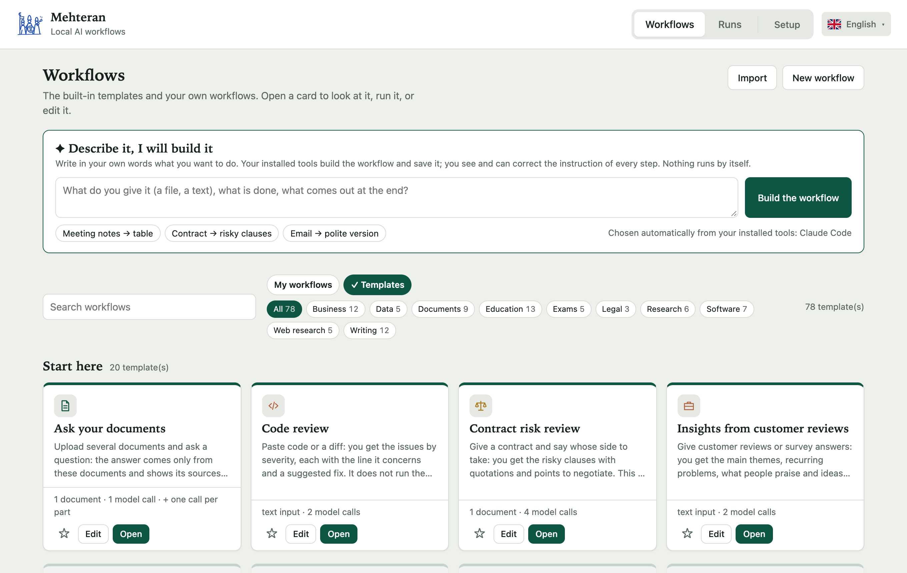

<p align="center"></p>

<h1 align="center">Mehteran</h1>

<p align="center"><b>AI workflows on your own computer, with the AI subscriptions you already have.</b></p>

<p align="center"><a href="README.tr.md">Türkçe</a> · <a href="https://tolgabuyuktanir.github.io/Mehteran/">Website</a> · <a href="https://tolgabuyuktanir.github.io/Mehteran/docs.html">Docs</a> · <a href="docs/mehteran.md">Full reference</a></p>



**Try a workflow:** Give **Meeting minutes and actions** your meeting notes. The workflow drafts a summary and action list, waits for your review, and exports the result as Word, HTML or Markdown.

[Run your first workflow](https://tolgabuyuktanir.github.io/Mehteran/docs.html?lang=en#run) · [Make it your own](https://tolgabuyuktanir.github.io/Mehteran/docs.html?lang=en#build)

Mehteran turns the AI tools you already use into repeatable workflows. A workflow reads a document, asks a model, checks the answer, lets a person approve and saves a Word or PDF file. Mehteran calls the AI through the command-line tools of your subscriptions (Claude Code, Codex, Antigravity CLI) or through models on this computer (Ollama, LM Studio, llama.cpp). It keeps no keys and no accounts of its own, and it charges nothing itself. You use your own plans, within their terms (see [Subscriptions and the providers' terms](#subscriptions-and-the-providers-terms)).

It runs on macOS, Windows and Linux, in 18 interface languages.

## Why Mehteran

- **No extra bill.** Mehteran removes API keys from every model call, so a tool cannot bill an API account by accident. A billed API key is used only when you allow it for that tool.
- **Your files stay with you.** The interface runs only on `127.0.0.1`. Runs, results and settings are folders on your disk. A workflow marked "local only" sends no text off the computer.
- **78 ready-made templates** in 10 categories: web research, documents, writing, business, legal, education, exams, research, data and software. Four of them are marked "Experimental": they depend on websites or paid services that change often.
- **Describe it, it is built**: write in a sentence what you need; your installed tools build the workflow, save it and show the instruction of every step, which you can edit. Or draw the steps on a canvas (AI steps, conditions, loops, human approvals). "Test this step" runs one step on its own.
- **Searches sites for you**: find home or car listings, or a hotel for your dates, compared in one table with links. A read-only browser does it without a window; it never books or contacts anyone.
- **Real documents in and out.** Reads PDF, Word, EPUB, Excel, web pages, scans (OCR) and recordings (speech to text). Saves Markdown, Word, HTML, PDF, EPUB, e-mail drafts, JSON and CSV.
- **Usage limits do not break a run.** A step waits for the limit to reset, or continues with the next model of your order.
- **Every run is kept**: watch it live, stop and resume it, compare two runs, edit a result and export it.

## Getting started

You do not need to install anything first. An internet connection is enough.

1. On this GitHub page, click **Code**, then **Download ZIP**. Unpack the zip file into a folder (for example `Documents/Mehteran`).
2. Start the interface:
   - **macOS:** right-click `Open Mehteran.command`, choose **Open**, and click **Open** again in the warning. macOS asks this only the first time, for files downloaded from the internet.
     If you see "you do not have appropriate access privileges": open Terminal, type `sh ` (with a space), drag `Open Mehteran.command` into the Terminal window and press Enter.
   - **Windows:** double-click `Open Mehteran.bat`. If "Windows protected your PC" appears, click **More info**, then **Run anyway**.
   - **Linux:** run `./mehter ui` in a terminal.
3. On the first start, if the computer has no suitable Python (3.11 or later), Mehteran installs a private Python for itself (a minute or two). Then the interface opens in the browser at `http://127.0.0.1:8766/`. It runs while its terminal window stays open.
4. On the **Setup** tab, install the AI tools you want and sign in. Then open a workflow on the **Workflows** tab and run it.

Next time, start it the same way (double-click is enough after the first time).

### With npm

If Node.js 18 or later is on the computer (Claude Code, Codex and Gemini CLI are installed with it), one command is enough:

```
npx mehteran
```

The first run installs the source bundled with the npm release into `~/Mehteran` and opens the interface. The installer needs `tar`. Next time, run `npx mehteran` again. Every command works the same way: `npx mehteran templates` is `./mehter templates`. To use another folder, set `MEHTERAN_DIR`.

## AI tools

| Tool | How it is paid | Where the text goes |
|---|---|---|
| Claude Code | Subscription (Claude Pro / Max) | Anthropic |
| Codex CLI | Subscription (a paid ChatGPT plan) | OpenAI |
| Antigravity CLI | Free Google account | Google |
| Ollama | Local | Stays on this computer |
| LM Studio, llama.cpp, vLLM (OpenAI-compatible local server) | Local | Stays on this computer |
| Gemini CLI | API key (billed) | Google |

You need at least one of them. The Setup tab installs the tools, signs you in and shows how much of each tool's usage limit is left (also in the header, on every tab). With `auto` as a step's model, Mehteran picks the first tool of your model order that is installed, signed in and not billed by an API key.

The optional local tools (Ollama, Tesseract OCR, Typst for PDF, Pandoc, whisper.cpp for speech to text, qpdf) are installed only when you ask, as pinned versions checked against SHA-256 sums.

## Subscriptions and the providers' terms

Mehteran starts the providers' own, unmodified command-line tools on your computer, signed in with your own account. It never reads, stores or forwards your sign-in.

- Anthropic's [Consumer Terms](https://www.anthropic.com/legal/consumer-terms), section 3.7, prohibit accessing the services "through automated or non-human means, whether through a bot, script, or otherwise". The exceptions are an Anthropic API key and uses that Anthropic explicitly permits.
- Claude Code's [legal page](https://code.claude.com/docs/en/legal-and-compliance) allows "an end user [...] signing in to the unmodified Claude Code binary with their own Claude subscription". It also says: "Advertised usage limits for Pro, Max, and Ultra plans assume ordinary, individual usage of Claude Code". Developers who build products "should use API key authentication".
- OpenAI documents `codex exec` for "repeatable workflows and pipelines" ([Codex CLI](https://developers.openai.com/codex/cli)). Its article on [Codex with a ChatGPT plan](https://help.openai.com/en/articles/11369540-using-codex-with-your-chatgpt-plan) does not address automation.
- Google's [Gemini CLI terms page](https://google-gemini.github.io/gemini-cli/docs/tos-privacy.html) says which terms apply to each sign-in type. It does not address automation.

So it is not clearly settled whether scheduled, batch or background runs on a consumer subscription are allowed. You are responsible for the use of your account. For heavy or unattended use (schedules, batches, the background), the providers recommend an API key: turn on "Allow an API key (billed)" for that tool on the Setup tab. A local model (Ollama, LM Studio) has no such terms.

**What Mehteran does by default:** scheduled and batch runs use only local models and tools with an API key. A step that would use a subscription or a free account is refused, with the reason, when the schedule is made or the batch starts; with the model `auto`, such tools are skipped. To allow subscriptions for these runs, turn on "Allow subscriptions and free accounts for scheduled and batch runs" under Setup → AI tools of the workflows. A run that you start yourself is not affected.

This is not legal advice. Checked on 24 November 2026; terms change.

## The book translation

The book translation app is no longer part of Mehteran. A computer that used it (a book in `books/`, or a `config.toml` in the code folder) keeps it: when its code is missing, Mehteran puts it back once from the git history, in the same place. `./translate ui` (Windows: `translate ui`), the books, the settings and the instructions keep working. The translation app gets no more updates. A copy installed from npm or a zip file is not changed. New installations do not get the translation app.

## Run storage

Restore individual runs from Trash in the Runs tab. Cleaning up old runs permanently deletes their files. The cleanup section shows Mehteran’s data size and free disk space.

Add these optional settings to `configurations/engine.toml` in the data folder to enable automatic maintenance. Automatic deletion is off by default.

```toml
retain_runs_days = 90
retain_usage_days = 365
max_run_storage_gib = 10
```

Maintenance runs when the interface starts and once a day while it stays open. `retain_runs_days` permanently deletes old finished runs, including those in Trash. `retain_usage_days` clears old usage records. The storage limit is checked before admitting new runs. Active runs can still write output beyond it.

## Command line

```
./mehter templates                                     list the templates
./mehter run <template or file> --input name=value     run a workflow
./mehter runs                                          the run history
./mehter update                                        bring a git copy up to date
./mehter doctor                                        check the installed AI tools (no model call)
./mehter eval [--model m] [--case id ...] [--out folder]   run the evaluation set
./mehter eval --compare before.json after.json         compare two evaluation reports
```

On Windows, use `mehter` instead of `./mehter`.

`mehter doctor` checks each installed AI tool without a model call. Every option that Mehteran passes must appear in the tool's `--help` (of its subcommand, for example `codex exec`). It also checks that Claude Code's `/usage` report can be read and whether Codex has a usage log. It prints one line per check. The exit code is 1 when a check failed. Run it after a tool update.

`mehter eval` runs the evaluation set in `evals/cases.json`: 7 cases over 6 core templates (`document-summary`, `meeting-minutes-actions`, `contract-risk-review`, `email-reply-draft`, `code-review`, `ask-your-documents`). One case asks a question that the document does not answer; one document hides an injected instruction. The runs make real model calls with the tools of the Setup tab, so they use your usage limits. Rules check each result: the output language, the required facts, forbidden text and the length. `--model` sets one model for every step of every case. The runs use a temporary data folder, so your run history stays clean. The report (JSON) goes to `<data>/evals/`. The checks are rules, not a judge: a passed case can still read badly.

## Updates

If you got the application with git (`git clone` or `gh repo clone`), `mehter update` brings it up to date. The launcher runs it each time before the interface starts. It fetches from GitHub and applies only a fast-forward merge. Without internet or a GitHub sign-in, or when the code was changed on this computer, it skips the update with a message, and Mehteran starts as it is.

For a new npm release, use `MEHTERAN_DIR` to install it in a new folder. Later runs of `npx mehteran` start the existing copy.

If you downloaded a zip file, download the new zip. Mehteran's workflows and runs are kept outside the code folder, so they stay where they are.

Codex, Node.js and the PDF reader go into the application's own folder (`.runtime/`). Claude Code, Antigravity CLI and the private Python (uv) go into your user folder (`~/.local/bin`; Windows: under `%LOCALAPPDATA%`). To remove the application, delete its folder and Mehteran's data folder (see the docs).

## Documentation

- [Website](https://tolgabuyuktanir.github.io/Mehteran/) and [docs](https://tolgabuyuktanir.github.io/Mehteran/docs.html): install, connect your AI tools, run and build workflows, local models, the workflow file, troubleshooting.
- [Mehteran full reference](docs/mehteran.md): every screen, setting, API route and limit.

## Development

- Code: `mehteran/`, Python standard library only (shared code such as the tool installer, document reading and the Word export is in `mehteran/common/`); the interface is plain JavaScript with no build step.
- Tests: `python3 -m unittest discover tests`. They use a fake AI tool and make no network calls. CI runs them on Ubuntu (Python 3.11 and 3.14), macOS and Windows (Python 3.12).
- The evaluation set (`evals/`, `mehter eval`) makes real model calls. CI does not run it.
- The npm package (`npx mehteran`) is in `npm/`: one Node script with no dependencies, which installs the code folder and starts its launcher. For a new version, raise `version` in `npm/package.json` and commit the change. `npm pack` puts an archive of the current commit into the package. Check the package, then publish it.
- The website is static HTML in `docs/` (`index.html`, `docs.html`, `assets/`); it loads nothing from other servers.

## Contributing

Bug reports, translation fixes and new templates are welcome. See [CONTRIBUTING.md](CONTRIBUTING.md). Report security problems privately, as described in [SECURITY.md](SECURITY.md).

## License

MIT. See [LICENSE](LICENSE).

Mehteran is an independent project. It is not affiliated with, endorsed by or sponsored by Anthropic, OpenAI or Google. Claude and Claude Code are trademarks of Anthropic; Codex and ChatGPT are trademarks of OpenAI; Gemini and Antigravity are trademarks of Google. Other names are trademarks of their owners.
