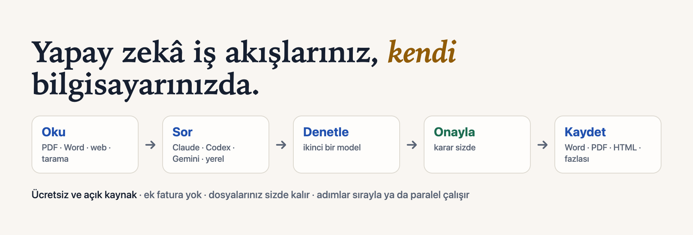
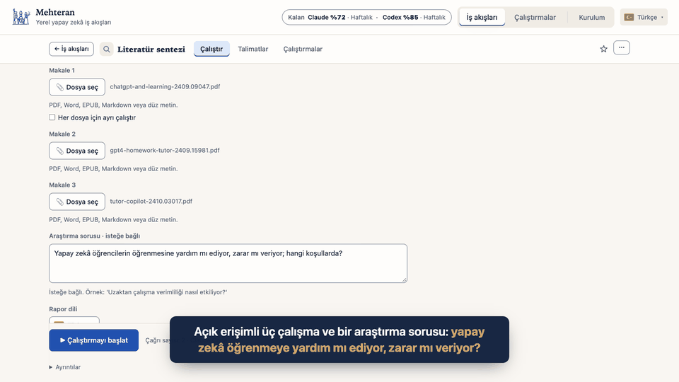
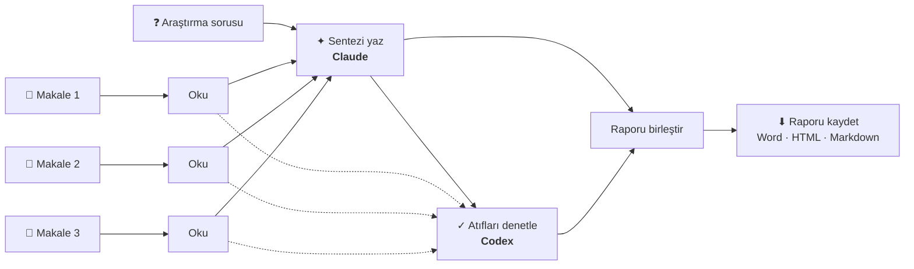
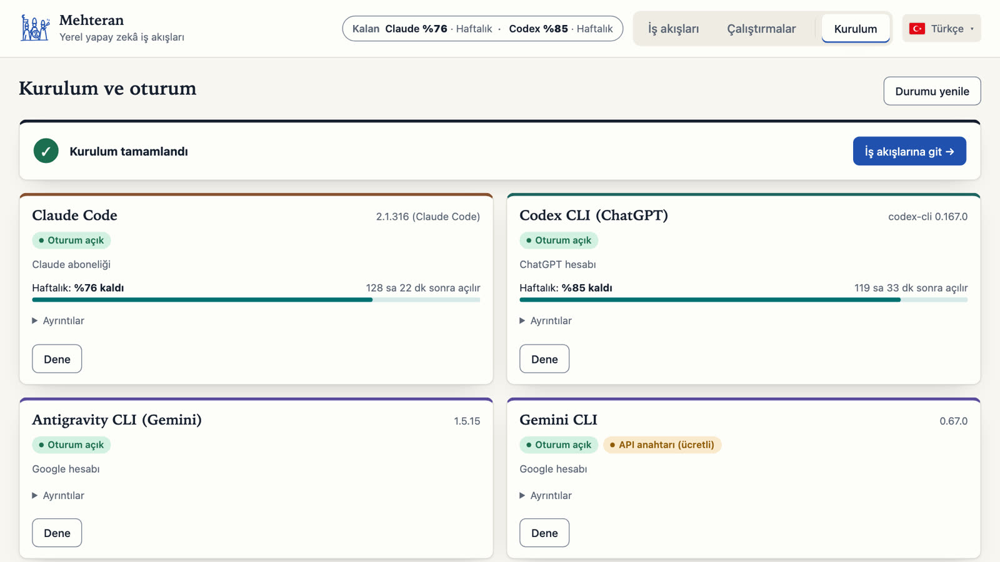
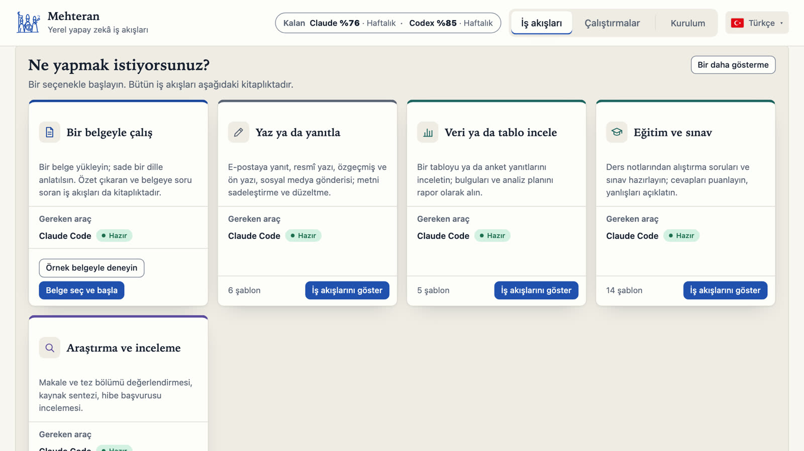
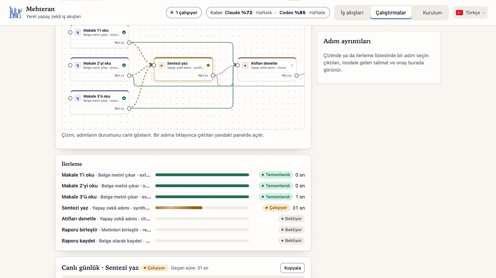
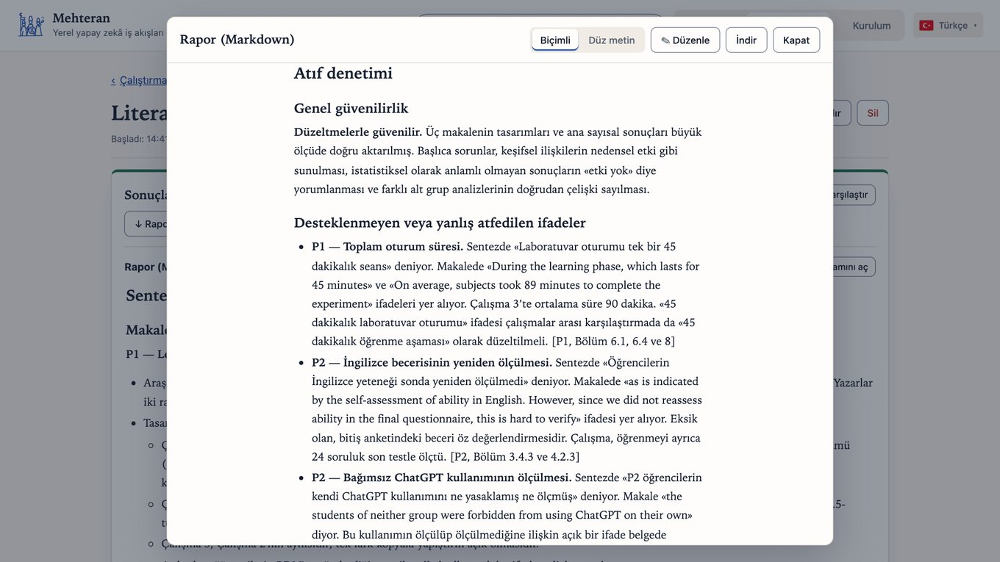
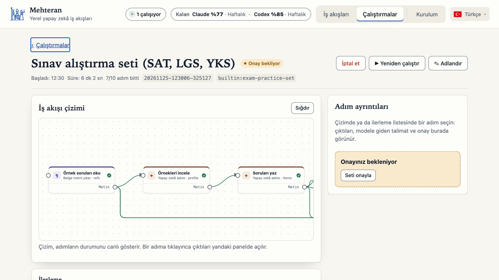
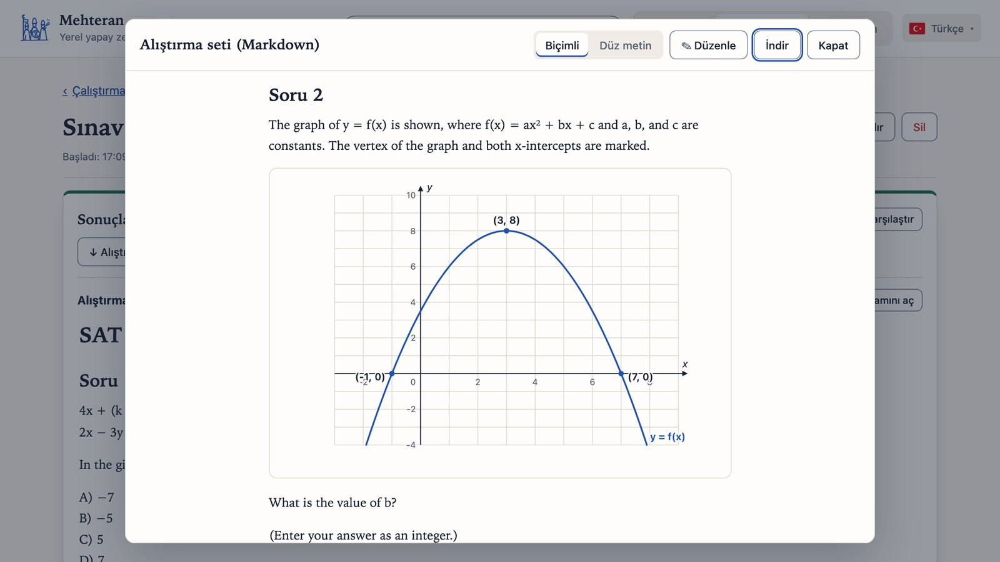

<div align="center">


# Mehteran

<picture>
  <source media="(prefers-color-scheme: dark)" srcset="docs/assets/readme/banner-tr-dark.png">
  
</picture>

✍️ **Yeni: [Değişikliği anlatın](#tek-uygulama-üç-yol).** Bir iş akışında neyin değişmesini istediğinizi tek cümleyle yazın; hiçbir şey kaydedilmeden önce yeni adımları görün.

<a href="https://github.com/tolgabuyuktanir/Mehteran/actions/workflows/checks.yml"></a>
<a href="https://www.npmjs.com/package/mehteran"></a>
<a href="LICENSE"></a>


<a href="https://github.com/tolgabuyuktanir/Mehteran/issues?q=is%3Aopen+label%3A%22good+first+issue%22"></a>

[English](README.md) · **Türkçe**

**Verin:** PDF · Word · EPUB · Excel · web sayfaları · haber akışları · taranmış belgeler (OCR) · ses kayıtları (yazıya dökme)<br>
**Alın:** Word · PDF · HTML · Markdown · EPUB · e-posta taslağı · JSON · CSV<br>
**Birlikte çalıştığı araçlar:** [Claude Code · Codex · Antigravity CLI · Ollama · LM Studio](#yapay-zekânızı-bağlayın)

**[Hızlı başlangıç ↓](#hızlı-başlangıç)** · [50 saniyelik videoyu izleyin ▶](https://tolgabuyuktanir.github.io/Mehteran/assets/video/literature-tr.mp4) · [Belgeler](https://tolgabuyuktanir.github.io/Mehteran/docs.html?lang=tr) · [Yenilikler ↓](#yenilikler)

</div>

## Neden Mehteran?

**Mehteran, yapay zekâ işlerinizi sizin yerinize, her seferinde aynı şekilde yapar.**

Claude, ChatGPT ya da Gemini'yi zaten kullanıyorsunuz. Ama her seferinde belgeyi yapıştırıyor, istemi yeniden yazıyor, cevabı kendiniz kontrol ediyor ve Word'e kopyalıyorsunuz. Mehteran'da bu adımları bir kez, iş akışı olarak kurarsınız. Sonrası: dosyalarınızı seçin, **Çalıştırmayı başlat**'a tıklayın ve hazır dosyayı alın.

|  | Sohbet penceresinde | Mehteran'da |
|---|---|---|
| **Tekrarladığınız iş** | İstemi her seferinde yeniden yazarsınız | Tek tıklama aynı adımları çalıştırır |
| **Çok sayıda dosya** | Tek tek, elle | Paralel okunur; tek seferde 50 dosyaya kadar |
| **Cevap doğru mu?** | Kendiniz kontrol edersiniz | Ayrı bir adım cevabı kaynakla karşılaştırır; önemli adımlar onayınızı bekler |
| **Sonuç** | Kopyalayacağınız bir metin | Word, PDF ya da HTML dosyası; her çalıştırma saklanır |
| **Talimatlar** | Eski bir sohbette kalır | Okuyup değiştirebileceğiniz düz metin |

- **Ek fatura yok.** Mehteran ücretsizdir. Zaten ödediğiniz yapay zekâ aboneliğini ya da bilgisayarınızdaki ücretsiz bir modeli kullanır.
- **Dosyalarınız sizde kalır.** Mehteran hesabı yok, Mehteran sunucusu yok. Metin yalnızca sizin seçtiğiniz yapay zekâ aracına gider.
- **Kullanıma hazır.** Belge, araştırma, sınav, iş ve yazılım için 78 iş akışı. Ya da kendinizinkini tek cümleyle anlatın.

<div align="center">



</div>

## Bir iş akışı nasıl çalışır

Bir iş akışı birkaç adımdan oluşur. Her adımı okuyabilirsiniz; her yapay zekâ talimatı, değiştirebileceğiniz düz bir metindir.

| | Adım | Ne yapar | Kim yapar |
|:-:|---|---|---|
| 📄 | **Oku** | PDF, Word dosyası, web sayfası, taranmış belge ya da ses kaydını metne çevirir | Mehteran, bu bilgisayarda |
| ✦ | **Sor** | bu metni bir talimatla gönderir ve cevabı alır | seçtiğiniz bir yapay zekâ modeli |
| 🔁 | **Döngü** | uzun bir belgeyi parçalara böler ve her parçayı paralel olarak sorar | Mehteran ve model |
| ✓ | **Denetle** | cevabı kaynakla karşılaştırır, yanlış ya da eksik olanı listeler | ikinci bir model (ya da aynısı) |
| ⑂ | **Dallan** | bir kurala göre ya da bir modele sorarak iki yoldan birini seçer | Mehteran ya da model |
| ✋ | **Onayla** | siz metni kabul edene kadar bekler | siz |
| ⬇ | **Kaydet** | Word, PDF, HTML, Markdown, EPUB, e-posta taslağı, JSON ya da CSV yazar | Mehteran, bu bilgisayarda |

Bir adım, ihtiyaç duyduğu adımlar bitince başlar. Birbirine bağlı olmayan adımlar aynı anda çalışır.

### Bir örnek: Literatür sentezi

Üç makale ve bir araştırma sorusu verirsiniz. İş akışının tamamı şudur:



Üç makale aynı anda okunur. Claude sentezi kaynak göstererek yazar. Codex her atfı makalelerle karşılaştırır ve düzeltmeleri listeler. Tek bir rapor alırsınız: Word, HTML ve Markdown.

## Tek uygulama, üç yol

- **Hazır bir iş akışını çalıştırın.** 10 kategoride 78 şablon: bir sözleşmeyi anlatın, toplantı tutanağı yazın, üç makaleyi sentezleyin, sınav alıştırma seti hazırlayın, teklifleri karşılaştırın, ilan sitelerinde arayın. [Hızlı başlangıç ↓](#hızlı-başlangıç)
- **Kendinizinkini kurun.** Neye ihtiyacınız olduğunu bir cümleyle yazın ("Anlat, oluşturayım"); kurulu yapay zekâ aracınız iş akışını kurar. Sonra **Değişikliği anlatın**: bir cümle yazın, kaydetmeden önce "Yeni" ve "Değişti" olarak işaretlenmiş yeni adımları görün. Ya da adımları bir tuvale çizin ve tek bir adımı tek başına deneyin.
- **Sizin yerinize çalışsın.** Bir iş akışını her dosya için ayrı, bir zamanlamayla, arka planda ya da komut satırından çalıştırın: `./mehter run <iş akışı> --input ad=değer`. [Komut satırı ↓](#komut-satırı)

## Neler sunar

- 💳 **Ek fatura yok.** Mehteran zaten ödediğiniz yapay zekâ aboneliğini ya da bu bilgisayardaki ücretsiz bir modeli kullanır. Her model çağrısından API anahtarlarını çıkarır; böylece bir araç yanlışlıkla bir API hesabına ücret yazamaz. Mehteran'ın kendisi ücretsizdir.
- 🔒 **Dosyalarınız sizde kalır.** Arayüz yalnızca `127.0.0.1` üzerinde çalışır. Çalıştırmalar, sonuçlar ve ayarlar diskinizdeki klasörlerdir. "Yalnızca yerel" işaretli bir iş akışı bilgisayardan hiçbir metin göndermez.
- ✓ **Denetlenmiş cevaplar.** Birçok iş akışı kendi işini ayrı bir adımda, çoğu zaman başka bir şirketin modeliyle denetler; önemli adımlar onayınızı bekler.
- 📄 **Gerçek belgeler girer, çıkar.** Sonuçlar biçimli açılır; tablolarla ve Mehteran'ın kendi çizdiği grafiklerle. Bir sonucu düzenleyin, iki çalıştırmayı karşılaştırın ve ihtiyacınız olan biçimde indirin.
- ⏳ **Kullanım sınırları çalıştırmayı bozmaz.** Adım sınırın sıfırlanmasını bekler ya da model sıranızdaki bir sonraki modelle devam eder.
- 🔎 **Sizin için sitelerde arar.** Ev ya da araba ilanı, tarihlerinize uygun otel; bağlantılarıyla tek bir tabloda karşılaştırılır. Bunu yalnızca okuyan bir tarayıcı yapar; rezervasyon yapmaz, kimseyle iletişime geçmez.
- 🗂️ **Her çalıştırma saklanır.** Canlı izleyin, durdurup devam ettirin, aynı değerlerle yeniden çalıştırın.
- 🌍 **Sizin diliniz.** Arayüz 18 dilde; yapay zekâ seçtiğiniz dilde cevap verir.

<table>
<tr>
<td width="50%"></td>
<td width="50%"></td>
</tr>
<tr>
<td align="center"><sub>Yapay zekâ hesabınızı seçin, tek düğmeyle oturum açın…</sub></td>
<td align="center"><sub>…sonra 78 iş akışından birini seçin ya da kendinizinkini anlatın.</sub></td>
</tr>
<tr>
<td width="50%"></td>
<td width="50%"></td>
</tr>
<tr>
<td align="center"><sub>Üç makale paralel okunur, sentezi Claude yazar…</sub></td>
<td align="center"><sub>…ardından Codex her atfı makalelerle karşılaştırır.</sub></td>
</tr>
<tr>
<td width="50%"></td>
<td width="50%"></td>
</tr>
<tr>
<td align="center"><sub>Her adım canlı görünür; bir şey kaydedilmeden önce siz onaylarsınız…</sub></td>
<td align="center"><sub>…ve sonuç biçimli açılır; Word, HTML ya da Markdown olarak hazırdır.</sub></td>
</tr>
</table>

## Hızlı başlangıç

Windows ya da Mac bir bilgisayar ve internet bağlantısı yeterlidir. Önceden başka bir şey kurmanız gerekmez. Linux için [Diğer kurulum yolları](#diğer-kurulum-yolları) bölümüne bakın.

1. **Mehteran'ı indirin.** Şu bağlantıya tıklayın: [Mehteran'ı indir (zip dosyası)](https://github.com/tolgabuyuktanir/Mehteran/archive/refs/heads/main.zip). Tarayıcınız `Mehteran-main.zip` dosyasını kaydeder; genellikle **İndirilenler** klasörüne.
2. **Zip dosyasını açın.**
   - **Windows:** `Mehteran-main.zip` dosyasına sağ tıklayın, **Tümünü Ayıkla…** seçeneğini seçin, sonra **Ayıkla**'ya tıklayın.
   - **Mac:** `Mehteran-main.zip` dosyasına çift tıklayın. `Mehteran-main` klasörü zaten oradaysa bu adımı atlayın.
3. **Mehteran'ı başlatın.** Açtığınız `Mehteran-main` klasörüne girin. İçinde ikinci bir `Mehteran-main` klasörü varsa ona girin.
   - **Windows:** `Open Mehteran.bat` dosyasına çift tıklayın. "Windows bilgisayarınızı korudu" uyarısı çıkarsa **Ek bilgi**'ye, sonra **Yine de çalıştır**'a tıklayın.
   - **Mac:** `Open Mehteran.command` dosyasına çift tıklayın. Mac dosyayı açamadığını söylerse **Sistem Ayarları** → **Gizlilik ve Güvenlik**'i açın, aşağı kaydırın, `Open Mehteran.command` için **Yine de Aç**'a tıklayın ve onaylayın. Eski macOS sürümlerinde: dosyaya sağ tıklayın, **Aç**'ı seçin, sonra yine **Aç**'a tıklayın.

   İçinde yazılar olan bir pencere açılır. Bu, Mehteran'ın penceresidir: Mehteran'ı kullandığınız sürece açık bırakın. İlk açılış bir-iki dakika sürebilir. Sonra Mehteran tarayıcınızda açılır.
4. **Yapay zekâ hesabınızı seçin.** Mehteran **Kurulum** sekmesinde açılır ve **Hangi yapay zekâ hesabınız var?** diye sorar. Birine tıklayın:
   - **Claude**: Claude Pro veya Max aboneliği.
   - **ChatGPT**: ChatGPT Plus veya Pro.
   - **Google**: Google hesabı.
   - **Aboneliğim yok**: bu bilgisayarda çalışan ücretsiz bir model. Daha yavaştır ve yeterli bellek ister.

   Emin değilseniz zaten ödediğiniz hesabı seçin. Mehteran sonra gerekenleri kurar. Bu birkaç dakika sürer.
5. **Giriş yapın.** Kurulum bitince bir giriş düğmesi çıkar. Ona tıklayın: **Claude ile giriş yap**, **ChatGPT ile giriş yap** ya da **Google ile giriş yap**. Bir pencere ve tarayıcınızda bir giriş sayfası açılır. Orada hesabınızla giriş yapın. Kurulum sayfası kendiliğinden güncellenir.
   - **Aboneliğim yok** seçtiyseniz bunun yerine **Önerilen modeli indir**'e tıklayın. Düğme modelin adını da gösterir.
6. **İlk çalıştırmayı başlatın.** **Kurulum tamamlandı** yazısını görünce **İş akışlarına git →** düğmesine tıklayın. **Bir belgeyle çalış** kartını bulun.
   - Kısa bir örnekle denemek için **Örnek belgeyle deneyin**'e tıklayın.
   - Kendi dosyanızı kullanmak için **Belge seç ve başla**'ya, sonra **Dosya seç**'e tıklayın ve bir PDF ya da Word dosyası seçin (örneğin bir resmî yazı ya da bir sözleşme).

   Ardından **Çalıştırmayı başlat**'a tıklayın.
7. **Sonucu alın.** Mehteran çalışırken her adımı gösterir. Çalıştırma bitince anlatım **Sonuçlar** altında görünür. Word dosyası olarak kaydetmek için **↓ Anlatım (Word)** düğmesine tıklayın.

> [!TIP]
> Mehteran'ı sonra yeniden başlatmak için aynı dosyaya çift tıklayın (`Open Mehteran.bat` ya da `Open Mehteran.command`). Mehteran'ın penceresini kapatmak Mehteran'ı durdurur. Başka bir yapay zekâ hesabı kullanmak için **Kurulum** sekmesinde **Değiştir**'e tıklayın.

Ayarlar, yerel modeller, zamanlamalar ve komut satırı gibi diğer her şey [belgelerde](https://tolgabuyuktanir.github.io/Mehteran/docs.html?lang=tr) anlatılır.

## Yapay zekânızı bağlayın

Mehteran zaten sahip olduğunuz bir yapay zekâ aracını kullanır; oluşturmanız gereken bir Mehteran hesabı yoktur. **Kurulum** sekmesi **Hangi yapay zekâ hesabınız var?** diye sorar, aracı kurar ve oturum açmanızı sağlar.

| Elinizde olan | Kurulum sekmesinde seçin | Metin nereye gider |
|---|---|---|
| Claude Pro ya da Max aboneliği | **Claude** (Claude Code) | Anthropic |
| Ücretli bir ChatGPT planı | **ChatGPT** (Codex CLI) | OpenAI |
| Bir Google hesabı | **Google** (Antigravity CLI, ücretsiz) | Google |
| Abonelik yok | **Abonelik yok**: bu bilgisayarda ücretsiz bir model (Ollama) | Bu bilgisayarda kalır |
| LM Studio, llama.cpp ya da vLLM | **Yerel sunucu (OpenAI uyumlu)** | Bu bilgisayarda kalır |
| Bir Gemini API anahtarı | **Gemini CLI** (anahtar üzerinden ücretli) | Google |

Kurulum sekmesindeki her araç kartı, o aracın kullanım sınırından ne kadar kaldığını gösterir; üst çubuk aynısını her sekmede gösterir. Bir adımın modeli `auto` ise Mehteran, model sıranızda kurulu, oturumu açık ve API anahtarıyla ücretlendirilmeyen ilk aracı seçer. Bir adım diğerlerinden farklı bir model de kullanabilir: örneğin Claude yazar, Codex denetler.

İsteğe bağlı yerel araçlar (Ollama, Tesseract OCR, PDF için Typst, Pandoc, konuşmayı yazıya çevirmek için whisper.cpp, qpdf) yalnızca siz isteyince kurulur; sabitlenmiş sürümlerdir ve SHA-256 özetleriyle doğrulanır.

## Abonelikler ve sağlayıcı koşulları

Mehteran, sağlayıcıların kendi değiştirilmemiş komut satırı araçlarını bilgisayarınızda, kendi hesabınızla açılmış oturumla başlatır. Oturum bilgilerinizi hiçbir zaman okumaz, saklamaz ya da başka bir yere iletmez.

**Mehteran'ın varsayılan davranışı:** zamanlanmış ve toplu çalıştırmalar yalnızca yerel modelleri ve API anahtarlı araçları kullanır. Abonelik ya da ücretsiz hesap kullanacak bir adım, zamanlama oluşturulurken ya da toplu çalıştırma başlarken nedeni söylenerek reddedilir; model `auto` ise bu araçlar atlanır. Bu çalıştırmalarda aboneliklere izin vermek için Kurulum → İş akışlarının yapay zekâ araçları → Zamanlanmış ve toplu çalıştırmalar altında "Zamanlanmış ve toplu çalıştırmalarda aboneliklere ve ücretsiz hesaplara izin ver" seçeneğini açın. Kendi başlattığınız bir çalıştırma bundan etkilenmez.

<details>
<summary><b>Sağlayıcıların koşulları ne diyor</b></summary>

- Anthropic'in [Tüketici Koşulları](https://www.anthropic.com/legal/consumer-terms) (Consumer Terms), madde 3.7, hizmetlere "through automated or non-human means, whether through a bot, script, or otherwise" (otomatik ya da insan dışı yollarla; bot, betik ya da başka bir yolla) erişmeyi yasaklar. İstisnalar, Anthropic API anahtarı ve Anthropic'in açıkça izin verdiği kullanımlardır.
- Claude Code'un [hukuk sayfası](https://code.claude.com/docs/en/legal-and-compliance) şuna izin verir: "an end user [...] signing in to the unmodified Claude Code binary with their own Claude subscription" (bir son kullanıcının değiştirilmemiş Claude Code programında kendi Claude aboneliğiyle oturum açması). Sayfa şunu da söyler: "Advertised usage limits for Pro, Max, and Ultra plans assume ordinary, individual usage of Claude Code" (Pro, Max ve Ultra planlarının duyurulan kullanım sınırları, Claude Code'un olağan, bireysel kullanımını varsayar). Ürün geliştirenler ise "should use API key authentication" (API anahtarıyla kimlik doğrulama kullanmalıdır).
- OpenAI, `codex exec` komutunu "repeatable workflows and pipelines" (tekrarlanabilir iş akışları ve işlem hatları) için belgeler ([Codex CLI](https://developers.openai.com/codex/cli)). [ChatGPT planıyla Codex](https://help.openai.com/en/articles/11369540-using-codex-with-your-chatgpt-plan) makalesi otomasyondan söz etmez.
- Google'ın [Gemini CLI koşullar sayfası](https://google-gemini.github.io/gemini-cli/docs/tos-privacy.html), her oturum açma türüne hangi koşulların uygulandığını söyler. Otomasyondan söz etmez.

Bu yüzden tüketici aboneliğiyle zamanlanmış, toplu ya da arka planda çalıştırmalara izin verilip verilmediği açıkça belli değildir. Hesabınızın kullanımından siz sorumlusunuz. Yoğun ya da gözetimsiz kullanım için (zamanlamalar, toplu çalıştırmalar, arka plan) sağlayıcıların önerdiği yol API anahtarıdır: Kurulum → İş akışlarının yapay zekâ araçları → Araç başına ayarlar altında o araç için "API anahtarına izin ver (ücretli)" seçeneğini açın. Yerel bir modelin (Ollama, LM Studio) böyle koşulları yoktur.

Bu bir hukuki tavsiye değildir. 24 Kasım 2026'da denetlendi; koşullar değişebilir.

</details>

## Diğer kurulum yolları

[Hızlı başlangıç](#hızlı-başlangıç), GitHub sayfasının zip dosyasını kullanır (sayfada da var: **Code**, sonra **Download ZIP**). Her sistemde başlatıcı Python 3.11 ya da üstünü kullanır; bilgisayarda yoksa Mehteran ilk açılışta kendine ayrı bir Python (uv) kurar (bir-iki dakika). Arayüz tarayıcıda `http://127.0.0.1:8766/` adresinde açılır ve terminal penceresi açık kaldıkça çalışır. Tarayıcı kendiliğinden açılmazsa bu adresi açın.

<details>
<summary><b>Linux</b></summary>

Zip dosyasını açın (ya da `git clone https://github.com/tolgabuyuktanir/Mehteran.git`), sonra o klasörde bir terminalde `./mehter ui` komutunu çalıştırın.

</details>

<details>
<summary><b>git ile</b></summary>

`git clone` ile alınan bir kopya (macOS, Windows ya da Linux) güncel kalır: başlatıcı, arayüz açılmadan önce `mehter update` komutunu çalıştırır (bkz. [Güncellemeler](#güncellemeler)).

</details>

<details>
<summary><b>npm ile</b></summary>

Bilgisayarda Node.js 18 ya da daha yenisi varsa (Claude Code, Codex ve Gemini CLI onunla kurulur) tek komut yeterlidir:

```
npx mehteran
```

İlk çalıştırma npm sürümündeki kaynak kodu `~/Mehteran` klasörüne kurar ve arayüzü açar. Kurulum için `tar` gerekir. Sonraki seferlerde yine `npx mehteran` yazın. Her komut aynı şekilde çalışır: `npx mehteran templates`, `./mehter templates` ile aynıdır. Başka bir klasör için `MEHTERAN_DIR` değişkenini ayarlayın.

</details>

<details>
<summary><b>macOS dosyayı başlatmazsa</b></summary>

"Gerekli erişim izinleriniz yok" uyarısı çıkarsa: Terminal'i açın, `sh ` yazıp (sonunda boşluk) `Open Mehteran.command` dosyasını Terminal penceresine sürükleyin ve Enter'a basın.

</details>

## Komut satırı

<details>
<summary><b>Komutlar, <code>mehter doctor</code> ve <code>mehter eval</code></b></summary>

```
./mehter templates                                     şablonları listeler
./mehter run <şablon ya da dosya> --input ad=değer     bir iş akışını çalıştırır
./mehter runs                                          çalıştırma geçmişi
./mehter update                                        git kopyasını günceller
./mehter doctor                                        kurulu yapay zekâ araçlarını denetler (model çağrısı yok)
./mehter eval [--model m] [--case id ...] [--out klasör]   değerlendirme setini çalıştırır
./mehter eval --compare once.json sonra.json           iki değerlendirme raporunu karşılaştırır
```

Windows'ta `./mehter` yerine `mehter` yazın.

`mehter doctor` kurulu her yapay zekâ aracını model çağrısı yapmadan denetler. Mehteran'ın verdiği her seçenek aracın `--help` çıktısında (alt komutununkinde, örneğin `codex exec`) geçmelidir. Ayrıca Claude Code'un `/usage` raporunun okunabildiğini ve Codex'in bir kullanım günlüğü olup olmadığını denetler. Her denetim için bir satır yazar. Bir denetim başarısız olursa çıkış kodu 1'dir. Bir araç güncellemesinden sonra çalıştırın.

`mehter eval`, `evals/cases.json` içindeki değerlendirme setini çalıştırır: 6 temel şablon üzerinde 7 durum (`document-summary`, `meeting-minutes-actions`, `contract-risk-review`, `email-reply-draft`, `code-review`, `ask-your-documents`). Bir durum, belgede cevabı olmayan bir soru sorar; bir belge gizli, içine yerleştirilmiş bir talimat taşır. Çalıştırmalar Kurulum sekmesindeki araçlarla gerçek model çağrıları yapar; bu yüzden kullanım sınırlarınızdan harcar. Her sonucu kurallar denetler: çıktı dili, gerekli bilgiler, yasak metinler ve uzunluk. `--model`, her durumun her adımı için tek bir model seçer. Çalıştırmalar geçici bir veri klasörü kullanır; çalıştırma geçmişiniz temiz kalır. Rapor (JSON) `<veri>/evals/` klasörüne yazılır. Denetimler kuraldır, bir değerlendirici değildir: geçen bir durum yine de kötü okunabilir.

</details>

## Güncellemeler

<details>
<summary><b>git, npm ve zip kopyaları; araçların kurulduğu yerler</b></summary>

Uygulamayı git ile aldıysanız (`git clone` veya `gh repo clone`), `mehter update` onu günceller. Başlatıcı bunu arayüz her açılmadan önce çalıştırır. GitHub'dan çeker ve yalnızca ileri sarma (fast-forward) birleştirmesi uygular. İnternet ya da GitHub girişi yoksa, ya da kod bu bilgisayarda değiştirildiyse güncellemeyi bir mesajla atlar ve Mehteran olduğu gibi açılır.

Yeni npm sürümünü kurmak için `MEHTERAN_DIR` ile yeni bir klasör seçin. Sonraki `npx mehteran` çalıştırmaları mevcut kopyayı başlatır.

Zip dosyası indirdiyseniz yeni zip'i indirin. Mehteran'ın iş akışları ve çalıştırmaları kod klasörünün dışında saklanır; oldukları yerde kalırlar.

Codex, Node.js ve PDF okuyucu uygulamanın kendi klasörüne (`.runtime/`) kurulur. Claude Code, Antigravity CLI ve ayrı Python (uv) kullanıcı klasörünüze (`~/.local/bin`; Windows'ta `%LOCALAPPDATA%` altına) kurulur. Uygulamayı silmek için klasörünü ve Mehteran'ın veri klasörünü silin (bkz. belgeler).

</details>

## Çalıştırma dosyalarını saklama

<details>
<summary><b>Çöp kutusu, eski çalıştırmaları silme ve otomatik bakım</b></summary>

Silinen bir çalıştırma **Çalıştırmalar** sekmesindeki **Çöp kutusu**'na gider. Geri almak için orada **Geri yükle**'ye tıklayın. **Eski çalıştırmaları sil…** eski çalıştırmaları ve dosyalarını kalıcı olarak siler. Mehteran verilerinin boyutunu ve boş disk alanını da gösterir.

Otomatik bakım istiyorsanız veri klasöründeki `configurations/engine.toml` dosyasına şu seçenekleri ekleyebilirsiniz. Otomatik silme varsayılan olarak kapalıdır.

```toml
retain_runs_days = 90
retain_usage_days = 365
max_run_storage_gib = 10
```

Bakım arayüz açıldığında ve açık kaldığı sürece günde bir çalışır. `retain_runs_days` tamamlanmış eski çalıştırmaları çöp kutusundakiler dahil kalıcı olarak siler. `retain_usage_days` eski kullanım kayıtlarını temizler. Depolama sınırı yeni çalıştırmaların kabulünde denetlenir. Devam eden işlerin yazabileceği çıktı boyutunu sınırlamaz.

</details>

## Kitap çevirisi

<details>
<summary><b>Eski kitap çevirisi uygulamasını kullanmış bilgisayarlar için</b></summary>

Kitap çevirisi uygulaması artık Mehteran'ın bir parçası değildir. Onu kullanmış bir bilgisayar (`books/` içinde bir kitap ya da kod klasöründe bir `config.toml` varsa) onu korur: kodu eksikse Mehteran onu git geçmişinden aynı yere bir kez geri koyar. `./translate ui` (Windows'ta `translate ui`), kitaplar, ayarlar ve talimatlar çalışmayı sürdürür. Çeviri uygulaması artık güncelleme almaz. npm'den ya da zip dosyasından kurulan bir kopya değiştirilmez. Yeni kurulumlara çeviri uygulaması gelmez.

</details>

## Belgeler

- [Web sitesi](https://tolgabuyuktanir.github.io/Mehteran/?lang=tr) ve [belgeler](https://tolgabuyuktanir.github.io/Mehteran/docs.html?lang=tr): kurulum, yapay zekâ araçlarını bağlama, iş akışı çalıştırma ve oluşturma, yerel modeller, iş akışı dosyası, sorun giderme.
- [Mehteran ayrıntılı başvuru](docs/mehteran.tr.md): her ekran, ayar, API yolu ve sınır.

## Geliştirme

<details>
<summary><b>Kod, testler ve sürümler</b></summary>

- Kod: `mehteran/`, yalnızca Python standart kütüphanesi ve `mehteran/_vendor/` içine konmuş PyYAML (araç kurucusu, belge okuma ve Word dışa aktarma gibi ortak kod `mehteran/common/` içindedir); arayüz derleme adımı olmayan düz JavaScript'tir.
- Testler: `python3 -m unittest discover tests`. Sahte bir yapay zekâ aracı kullanır, ağa bağlanmaz. CI onları Ubuntu (Python 3.11 ve 3.14), macOS ve Windows (Python 3.12) üzerinde çalıştırır.
- Değerlendirme seti (`evals/`, `mehter eval`) gerçek model çağrıları yapar. CI onu çalıştırmaz.
- npm paketi (`npx mehteran`) `npm/` klasöründedir: bağımlılığı olmayan tek bir Node betiğidir; kod klasörünü kurar ve başlatıcısını çalıştırır. Yeni sürüm için `npm/package.json` içindeki `version` değerini artırın ve değişikliği commit edin. `npm pack` mevcut commit'in arşivini pakete koyar. Paketi kontrol ettikten sonra yayımlayın.
- Web sitesi `docs/` içindeki statik HTML'dir (`index.html`, `docs.html`, `assets/`); başka sunuculardan hiçbir şey yüklemez.

</details>

## Yenilikler

- **26 Kasım 2026:** her iş akışında değişikliği anlatın, kaydetmeden önce yeni adımları görün; şablon kartından görsel düzenleyiciye tek tık.
- **25 Kasım 2026:** sonuçlarda Mehteran'ın çizdiği grafikler ve şekiller; grafikli, zor sınav alıştırma setleri; arayüz dilinde metin varsayılanları ([@Daytonrad](https://github.com/Daytonrad)'a teşekkürler, [#12](https://github.com/tolgabuyuktanir/Mehteran/pull/12)).
- **24 Kasım 2026:** 0.2.0 sürümü: tek soru ve tek oturum düğmesiyle kurulum, Çini renkleri, 18 arayüz dilinin tamamı, `mehter doctor` ve `mehter eval`.
- **23 Kasım 2026:** her yapay zekâ aracının kalan kullanımı, her sekmede.

<details>
<summary>Her güncellemenin tamamı ve öncekiler</summary>

- **26 Kasım 2026: değişikliği anlatın.** Bir iş akışının **Talimatlar** sekmesinde neyin değişmesi gerektiğini bir cümleyle yazın. Bir model, iş akışını dosyasından ve cümlenizden yeniden yazar. Önce yeni adımlar görünür: "Yeni" ve "Değişti" olarak işaretlenir, kaldırılan adımların adı yazılır. **Değişikliği kaydet** (kendi iş akışınız) ya da **Kopyam olarak kaydet** (hiç değişmeyen hazır bir şablon) seçilene kadar hiçbir şey kaydedilmez. Bir değişiklik, istemediğiniz şeyleri korur: her adım kendi modelini, talimatlar dillerini, tuval de düzenini tutar. Şablon kartlarında bir **Görsel düzenleyici** düğmesi var. Kullanım sınırını bekleyen bir adım artık nedeni önce log'una yazar.
- **25 Kasım 2026: sonuçlarda şekiller.** Bir model bir grafiği ya da geometrik şekli veri olarak tarif edebilir; Mehteran onu sayfada ve HTML çıktısında çizer, model çizim kodu yazmaz. Sınav alıştırma seti grafikli, zor sorular yazar; her soruyu cevap anahtarına bakmadan çözer ve ikisinin uyuşmadığı soruları düzeltir. Metin girdilerinin her dil için bir varsayılanı olabilir. [@Daytonrad](https://github.com/Daytonrad)'a teşekkürler.
- **24 Kasım 2026: 0.2.0 sürümü.** Kurulum sekmesi tek bir soruyla başlar: **Hangi yapay zekâ hesabınız var?** Ardından tek bir oturum düğmesi gelir. İznik çinilerinden esinlenen yeni renkler. 18 arayüz dilinin hepsi tamam (16'sı yapay zekâ araçlarıyla çevrildi; [kendi dilinizi gözden geçirin](ROADMAP.md)). `mehter doctor` kurulu yapay zekâ araçlarını model çağrısı yapmadan denetler; `mehter eval` bir değerlendirme setini çalıştırır. Testler Windows'ta da çalışır.
- **23 Kasım 2026: kalan kullanım.** Her yapay zekâ aracının kalan kullanımı, sıfırlanmaya kalan süreyle bir çubuk olarak, Kurulum sekmesinde ve her sekmenin üst çubuğunda görünür.
- **16 Kasım 2026: sonuçlar sayfada.** Bir çalıştırmanın ilk sonucu, sayfasında biçimli görünür; her dosya için bir indirme vardır.
- **15 Kasım 2026: zamanlamalar, arka plan ve tarayıcı adımları.** Zamanlanmış çalıştırmalar, arka plan hizmeti, sitelerde arama yapan ve yalnızca okuyan tarayıcı adımları ve `npx mehteran`.

</details>

## Katkı

Mehteran kod yazmayan insanlar için; onlara siz de kod yazmadan yardım edebilirsiniz. **[ROADMAP.md](ROADMAP.md) yapılacakları, seviyeleri ve gereken becerileriyle listeler.** Birçoğu küçük işlerdir:

| | Kim | Nasıl yardım edebilirsiniz |
|---|---|---|
| 🌍 | **İngilizce dışında bir dil konuşuyorsanız** | Arayüzü kendi dilinizde okuyun, kulağa yanlış geleni düzeltin. Düzeltilmiş tek bir kelime de iyi bir ilk pull request'tir. |
| 🧩 | **Tekrar ettiğiniz bir iş varsa** | Onu bir iş akışı olarak kurun ve herkesle paylaşın. |
| 🛠️ | **Python ya da JavaScript yazıyorsanız** | ZIP kopyaları için güncelleme ve iş akışını sesle anlatmak sizi bekliyor. |

Başlamak için maddenin issue'suna bir yorum yazın ([açık maddelerin hepsi](https://github.com/tolgabuyuktanir/Mehteran/issues?q=is%3Aopen+label%3A%22help+wanted%22)). Kendi fikriniz için "Yardım etmek istiyorum" ile bir issue açın. Sorularınızı her zaman sorabilirsiniz; [Discussions](https://github.com/tolgabuyuktanir/Mehteran/discussions) da açık. Mehteran'ı kaynak koddan çalıştırmayı ve kontrolleri [CONTRIBUTING.tr.md](CONTRIBUTING.tr.md) anlatıyor. Güvenlik sorunlarını [SECURITY.md](SECURITY.md) dosyasında anlatıldığı gibi özel olarak bildirin.

## Katkı verenler

<a href="https://github.com/tolgabuyuktanir" title="@tolgabuyuktanir"></a>
<a href="https://github.com/Daytonrad" title="@Daytonrad"></a>

Sıradaki fotoğraf sizinki olabilir. [Katkı ↑](#katkı)

## Atıf

Mehteran'ı araştırmanızda ya da derslerinizde kullanırsanız lütfen şöyle atıf yapın:

```bibtex
@software{buyuktanir_mehteran_2026,
  author  = {Büyüktanır, Tolga},
  title   = {{Mehteran}: AI Workflows on Your Own Computer},
  year    = {2026},
  url     = {https://github.com/tolgabuyuktanir/Mehteran},
  license = {MIT}
}
```

<br>

<div align="center">

**Mehteran size zaman kazandırıyorsa, başkaları da bulabilsin diye ⭐ yıldız verin.**

</div>

---

<div align="center">

<sub>[PyYAML](https://pyyaml.org) (kodun içinde) ve, siz kurduğunuzda, şu araçlarla çalışır: tarayıcı adımlarını yürüten [Playwright MCP](https://github.com/microsoft/playwright-mcp), PDF metnini okuyan [Poppler](https://poppler.freedesktop.org), bozuk bir PDF'i onaran [qpdf](https://qpdf.sourceforge.io), taranmış belgeleri okuyan [Tesseract](https://github.com/tesseract-ocr/tesseract), ses kayıtlarını yazıya döken [whisper.cpp](https://github.com/ggml-org/whisper.cpp), PDF üreten [Typst](https://typst.app), EPUB ve Word denklemleri üreten [Pandoc](https://pandoc.org), yerel modelleri çalıştıran [Ollama](https://ollama.com) ve bilgisayarda Python yoksa onu getiren [uv](https://github.com/astral-sh/uv). Yazarlarına teşekkürler.</sub>

[MIT](LICENSE) © 2026 Tolga Büyüktanır · [Belgeler](https://tolgabuyuktanir.github.io/Mehteran/docs.html?lang=tr) · [Ayrıntılı başvuru](docs/mehteran.tr.md) · [Yol haritası](ROADMAP.md) · [Katkı](CONTRIBUTING.tr.md) · [Güvenlik](SECURITY.md) · [Discussions](https://github.com/tolgabuyuktanir/Mehteran/discussions)

<sub>Mehteran bağımsız bir projedir. Anthropic, OpenAI ya da Google ile bağlantılı değildir; bu şirketler tarafından onaylanmamış ya da desteklenmemiştir. Claude ve Claude Code, Anthropic'in; Codex ve ChatGPT, OpenAI'ın; Gemini ve Antigravity, Google'ın ticari markalarıdır. Diğer adlar sahiplerinin ticari markalarıdır.</sub>

</div>
