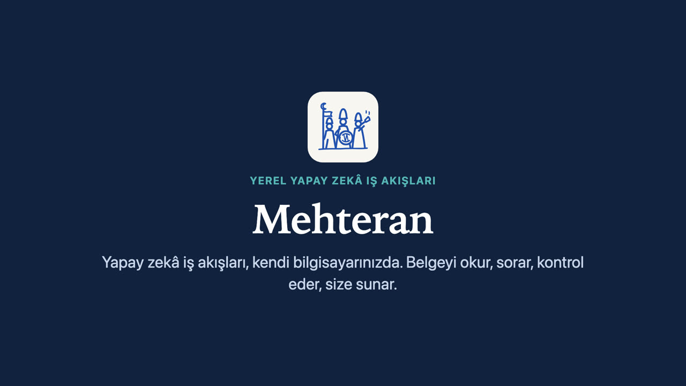
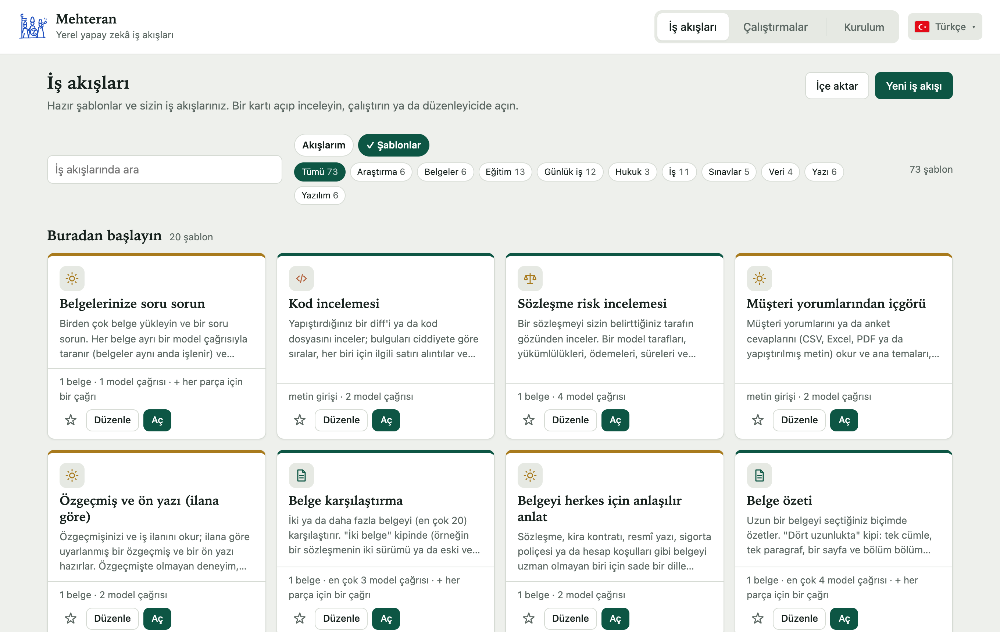

<p align="center"></p>

<h1 align="center">Mehteran</h1>

<p align="center"><b>Kendi bilgisayarınızda, zaten sahip olduğunuz yapay zekâ abonelikleriyle iş akışları.</b></p>

<p align="center"><a href="README.md">English</a> · <a href="https://tolgabuyuktanir.github.io/Mehteran/?lang=tr">Web sitesi</a> · <a href="https://tolgabuyuktanir.github.io/Mehteran/docs.html?lang=tr">Belgeler</a> · <a href="docs/mehteran.tr.md">Ayrıntılı başvuru</a></p>

Mehteran, yapay zekâyla tekrarlanan işleri kendi bilgisayarınızda yapar. Örneğin bir belgeyi okur, yapay zekâdan bir özet ister, onayınızı bekler ve sonucu Word dosyası olarak kaydeder. Zaten sahip olduğunuz yapay zekâ hesabını (Claude, ChatGPT ya da Google) ya da bu bilgisayarda çalışan ücretsiz bir modeli kullanır. Mehteran'ın kendisi ücretsizdir.

<p align="center"><a href="https://tolgabuyuktanir.github.io/Mehteran/?lang=tr"></a><br><a href="https://tolgabuyuktanir.github.io/Mehteran/?lang=tr">▶ 37 saniyede Mehteran'ı izleyin (sessiz)</a></p>

## Hızlı başlangıç

Windows ya da Mac bir bilgisayar ve internet bağlantısı yeterlidir. Önceden başka bir şey kurmanız gerekmez. Linux için [Diğer kurulum yolları](#diğer-kurulum-yolları) bölümüne bakın.

1. **Mehteran'ı indirin.** Şu bağlantıya tıklayın: [Mehteran'ı indir (zip dosyası)](https://github.com/tolgabuyuktanir/Mehteran/archive/refs/heads/main.zip). Tarayıcınız `Mehteran-main.zip` dosyasını kaydeder; genellikle **İndirilenler** klasörüne.
2. **Zip dosyasını açın.**
   - **Windows:** `Mehteran-main.zip` dosyasına sağ tıklayın, **Tümünü Ayıkla…** seçeneğini seçin, sonra **Ayıkla**'ya tıklayın.
   - **Mac:** `Mehteran-main.zip` dosyasına çift tıklayın. `Mehteran-main` klasörü zaten oradaysa bu adımı atlayın.
3. **Mehteran'ı başlatın.** Açtığınız `Mehteran-main` klasörüne girin. İçinde ikinci bir `Mehteran-main` klasörü varsa ona girin.
   - **Windows:** `Open Mehteran.bat` dosyasına çift tıklayın. "Windows bilgisayarınızı korudu" uyarısı çıkarsa **Ek bilgi**'ye, sonra **Yine de çalıştır**'a tıklayın.
   - **Mac:** `Open Mehteran.command` dosyasına çift tıklayın. Mac dosyayı açamadığını söylerse **Sistem Ayarları** → **Gizlilik ve Güvenlik**'i açın, aşağı kaydırın, `Open Mehteran.command` için **Yine de Aç**'a tıklayın ve onaylayın. Eski macOS sürümlerinde: dosyaya sağ tıklayın, **Aç**'ı seçin, sonra yine **Aç**'a tıklayın.

   İçinde yazılar olan bir pencere açılır. Bu, Mehteran'ın penceresidir: Mehteran'ı kullandığınız sürece açık bırakın. İlk açılış bir-iki dakika sürebilir. Sonra Mehteran tarayıcınızda açılır.
4. **Yapay zekâ hesabınızı seçin.** Mehteran **Kurulum** sekmesinde açılır ve **Hangi yapay zekâ hesabınız var?** diye sorar. Birine tıklayın:
   - **Claude**: Claude Pro veya Max aboneliği.
   - **ChatGPT**: ChatGPT Plus veya Pro.
   - **Google**: Google hesabı.
   - **Aboneliğim yok**: bu bilgisayarda çalışan ücretsiz bir model. Daha yavaştır ve yeterli bellek ister.

   Emin değilseniz zaten ödediğiniz hesabı seçin. Mehteran sonra gerekenleri kurar. Bu birkaç dakika sürer.
5. **Giriş yapın.** Kurulum bitince bir giriş düğmesi çıkar. Ona tıklayın: **Claude ile giriş yap**, **ChatGPT ile giriş yap** ya da **Google ile giriş yap**. Bir pencere ve tarayıcınızda bir giriş sayfası açılır. Orada hesabınızla giriş yapın. Kurulum sayfası kendiliğinden güncellenir.
   - **Aboneliğim yok** seçtiyseniz bunun yerine **Önerilen modeli indir**'e tıklayın. Düğme modelin adını da gösterir.
6. **İlk çalıştırmayı başlatın.** **Kurulum tamamlandı** yazısını görünce **İş akışlarına git →** düğmesine tıklayın. **Bir belgeyle çalış** kartını bulun.
   - Kısa bir örnekle denemek için **Örnek belgeyle deneyin**'e tıklayın.
   - Kendi dosyanızı kullanmak için **Belge seç ve başla**'ya, sonra **Dosya seç**'e tıklayın ve bir PDF ya da Word dosyası seçin (örneğin bir resmî yazı ya da bir sözleşme).

   Ardından **Çalıştırmayı başlat**'a tıklayın.
7. **Sonucu alın.** Mehteran çalışırken her adımı gösterir. Çalıştırma bitince anlatım **Sonuçlar** altında görünür. Word dosyası olarak kaydetmek için **↓ Anlatım (Word)** düğmesine tıklayın.

Mehteran'ı sonra yeniden başlatmak için aynı dosyaya çift tıklayın (`Open Mehteran.bat` ya da `Open Mehteran.command`). Mehteran'ın penceresini kapatmak Mehteran'ı durdurur. Başka bir yapay zekâ hesabı kullanmak için **Kurulum** sekmesinde **Değiştir**'e tıklayın.

Ayarlar, yerel modeller, zamanlamalar ve komut satırı gibi diğer her şey [belgelerde](https://tolgabuyuktanir.github.io/Mehteran/docs.html?lang=tr) anlatılır.

## Daha fazlasını deneyin



Toplantı notlarınızı **Toplantı tutanağı ve aksiyonlar** iş akışına verin. İş akışı bir özet ve bir aksiyon listesi hazırlar, incelemenizi bekler ve sonucu Word, HTML ya da Markdown dosyası olarak kaydeder.

[İlk iş akışınızı çalıştırın](https://tolgabuyuktanir.github.io/Mehteran/docs.html?lang=tr#tr-calistir) · [Kendi iş akışınızı oluşturun](https://tolgabuyuktanir.github.io/Mehteran/docs.html?lang=tr#tr-olustur)

## Neden Mehteran

Mehteran, zaten kullandığınız yapay zekâ araçlarını tekrar tekrar kullanılabilen iş akışlarına dönüştürür. Bir iş akışı belgeyi okur, modele sorar, cevabı kontrol eder, bir kişinin onayını alır ve sonucu Word ya da PDF olarak kaydeder. Mehteran yapay zekâyı aboneliklerinizin komut satırı araçlarıyla (Claude Code, Codex, Antigravity CLI) ya da bu bilgisayardaki modellerle (Ollama, LM Studio, llama.cpp) çağırır. Kendi anahtarı ve hesabı yoktur; hiçbir ücret almaz. Kendi planlarınızı, onların koşulları içinde kullanırsınız (bkz. [Abonelikler ve sağlayıcı koşulları](#abonelikler-ve-sağlayıcı-koşulları)). macOS, Windows ve Linux'ta, 18 arayüz dilinde çalışır.

- **Ek fatura yok.** Mehteran her model çağrısından API anahtarlarını çıkarır; böylece bir araç yanlışlıkla bir API hesabına ücret yazamaz. Ücretli bir API anahtarı yalnızca o araç için izin verirseniz kullanılır.
- **Dosyalarınız sizde kalır.** Arayüz yalnızca `127.0.0.1` üzerinde çalışır. Çalıştırmalar, sonuçlar ve ayarlar diskinizdeki klasörlerdir. "Yalnızca yerel" işaretli bir iş akışı bilgisayardan hiçbir metin göndermez.
- **10 kategoride 78 hazır şablon:** internetten araştırma, belgeler, yazı, iş, hukuk, eğitim, sınavlar, araştırma, veri ve yazılım. Bunların dördü "Deneysel" olarak işaretlidir: sık değişen web sitelerine ya da ücretli servislere bağlıdırlar.
- **"Anlat, oluşturayım":** ne istediğinizi bir cümleyle yazın. Kurulu yapay zekâ aracınız iş akışını kurar ve kaydeder; o çalışırken dökümünü izlersiniz. Sonra her adımın talimatını görür ve düzenleyebilirsiniz. Ya da adımları bir tuvale çizin (yapay zekâ adımları, koşullar, döngüler, kişi onayları). "Bu adımı dene" tek bir adımı tek başına çalıştırır.
- **Sizin için sitelerde arar:** ev ya da araba ilanı, tarihlerinize uygun otel; bağlantılarıyla tek bir tabloda karşılaştırılır. Bunu yalnızca okuyan bir tarayıcı pencere açmadan yapar; rezervasyon yapmaz, kimseyle iletişime geçmez.
- **Gerçek belgeler girer, çıkar.** PDF, Word, EPUB, Excel, web sayfaları, taranmış belgeler (OCR) ve ses kayıtlarını (konuşmayı yazıya çevirme) okur. Markdown, Word, HTML, PDF, EPUB, e-posta taslağı, JSON ve CSV olarak kaydeder.
- **Kullanım sınırları çalıştırmayı bozmaz.** Adım sınırın sıfırlanmasını bekler ya da model sıranızdaki bir sonraki modelle devam eder.
- **Her çalıştırma saklanır:** canlı izleyin, durdurup devam ettirin, iki çalıştırmayı karşılaştırın, bir sonucu düzenleyip dışa aktarın.

## Yapay zekâ araçları

| Araç | Nasıl ödenir | Metin nereye gider |
|---|---|---|
| Claude Code | Abonelik (Claude Pro / Max) | Anthropic |
| Codex CLI | Abonelik (ücretli bir ChatGPT planı) | OpenAI |
| Antigravity CLI | Ücretsiz Google hesabı | Google |
| Ollama | Yerel | Bu bilgisayarda kalır |
| LM Studio, llama.cpp, vLLM (OpenAI uyumlu yerel sunucu) | Yerel | Bu bilgisayarda kalır |
| Gemini CLI | API anahtarı (ücretli) | Google |

En az birine ihtiyacınız var. Kurulum sekmesi araçları kurar ve oturum açmanızı sağlar. Kurulum sekmesindeki her araç kartı, o aracın kullanım sınırından ne kadar kaldığını gösterir; üst çubuk aynısını her sekmede gösterir. Bir adımın modeli `auto` ise Mehteran, model sıranızda kurulu, oturumu açık ve API anahtarıyla ücretlendirilmeyen ilk aracı seçer.

İsteğe bağlı yerel araçlar (Ollama, Tesseract OCR, PDF için Typst, Pandoc, konuşmayı yazıya çevirmek için whisper.cpp, qpdf) yalnızca siz isteyince kurulur; sabitlenmiş sürümlerdir ve SHA-256 özetleriyle doğrulanır.

## Abonelikler ve sağlayıcı koşulları

Mehteran, sağlayıcıların kendi değiştirilmemiş komut satırı araçlarını bilgisayarınızda, kendi hesabınızla açılmış oturumla başlatır. Oturum bilgilerinizi hiçbir zaman okumaz, saklamaz ya da başka bir yere iletmez.

- Anthropic'in [Tüketici Koşulları](https://www.anthropic.com/legal/consumer-terms) (Consumer Terms), madde 3.7, hizmetlere "through automated or non-human means, whether through a bot, script, or otherwise" (otomatik ya da insan dışı yollarla; bot, betik ya da başka bir yolla) erişmeyi yasaklar. İstisnalar, Anthropic API anahtarı ve Anthropic'in açıkça izin verdiği kullanımlardır.
- Claude Code'un [hukuk sayfası](https://code.claude.com/docs/en/legal-and-compliance) şuna izin verir: "an end user [...] signing in to the unmodified Claude Code binary with their own Claude subscription" (bir son kullanıcının değiştirilmemiş Claude Code programında kendi Claude aboneliğiyle oturum açması). Sayfa şunu da söyler: "Advertised usage limits for Pro, Max, and Ultra plans assume ordinary, individual usage of Claude Code" (Pro, Max ve Ultra planlarının duyurulan kullanım sınırları, Claude Code'un olağan, bireysel kullanımını varsayar). Ürün geliştirenler ise "should use API key authentication" (API anahtarıyla kimlik doğrulama kullanmalıdır).
- OpenAI, `codex exec` komutunu "repeatable workflows and pipelines" (tekrarlanabilir iş akışları ve işlem hatları) için belgeler ([Codex CLI](https://developers.openai.com/codex/cli)). [ChatGPT planıyla Codex](https://help.openai.com/en/articles/11369540-using-codex-with-your-chatgpt-plan) makalesi otomasyondan söz etmez.
- Google'ın [Gemini CLI koşullar sayfası](https://google-gemini.github.io/gemini-cli/docs/tos-privacy.html), her oturum açma türüne hangi koşulların uygulandığını söyler. Otomasyondan söz etmez.

Bu yüzden tüketici aboneliğiyle zamanlanmış, toplu ya da arka planda çalıştırmalara izin verilip verilmediği açıkça belli değildir. Hesabınızın kullanımından siz sorumlusunuz. Yoğun ya da gözetimsiz kullanım için (zamanlamalar, toplu çalıştırmalar, arka plan) sağlayıcıların önerdiği yol API anahtarıdır: Kurulum → İş akışlarının yapay zekâ araçları → Araç başına ayarlar altında o araç için "API anahtarına izin ver (ücretli)" seçeneğini açın. Yerel bir modelin (Ollama, LM Studio) böyle koşulları yoktur.

**Mehteran'ın varsayılan davranışı:** zamanlanmış ve toplu çalıştırmalar yalnızca yerel modelleri ve API anahtarlı araçları kullanır. Abonelik ya da ücretsiz hesap kullanacak bir adım, zamanlama oluşturulurken ya da toplu çalıştırma başlarken nedeni söylenerek reddedilir; model `auto` ise bu araçlar atlanır. Bu çalıştırmalarda aboneliklere izin vermek için Kurulum → İş akışlarının yapay zekâ araçları → Zamanlanmış ve toplu çalıştırmalar altında "Zamanlanmış ve toplu çalıştırmalarda aboneliklere ve ücretsiz hesaplara izin ver" seçeneğini açın. Kendi başlattığınız bir çalıştırma bundan etkilenmez.

Bu bir hukuki tavsiye değildir. 24 Kasım 2026'da denetlendi; koşullar değişebilir.

## Diğer kurulum yolları

[Hızlı başlangıç](#hızlı-başlangıç), GitHub sayfasının zip dosyasını kullanır (sayfada da var: **Code**, sonra **Download ZIP**). Her sistemde başlatıcı Python 3.11 ya da üstünü kullanır; bilgisayarda yoksa Mehteran ilk açılışta kendine ayrı bir Python (uv) kurar (bir-iki dakika). Arayüz tarayıcıda `http://127.0.0.1:8766/` adresinde açılır ve terminal penceresi açık kaldıkça çalışır. Tarayıcı kendiliğinden açılmazsa bu adresi açın.

### Linux

Zip dosyasını açın (ya da `git clone https://github.com/tolgabuyuktanir/Mehteran.git`), sonra o klasörde bir terminalde `./mehter ui` komutunu çalıştırın.

### git ile

`git clone` ile alınan bir kopya (macOS, Windows ya da Linux) güncel kalır: başlatıcı, arayüz açılmadan önce `mehter update` komutunu çalıştırır (bkz. [Güncellemeler](#güncellemeler)).

### npm ile

Bilgisayarda Node.js 18 ya da daha yenisi varsa (Claude Code, Codex ve Gemini CLI onunla kurulur) tek komut yeterlidir:

```
npx mehteran
```

İlk çalıştırma npm sürümündeki kaynak kodu `~/Mehteran` klasörüne kurar ve arayüzü açar. Kurulum için `tar` gerekir. Sonraki seferlerde yine `npx mehteran` yazın. Her komut aynı şekilde çalışır: `npx mehteran templates`, `./mehter templates` ile aynıdır. Başka bir klasör için `MEHTERAN_DIR` değişkenini ayarlayın.

### macOS dosyayı başlatmazsa

"Gerekli erişim izinleriniz yok" uyarısı çıkarsa: Terminal'i açın, `sh ` yazıp (sonunda boşluk) `Open Mehteran.command` dosyasını Terminal penceresine sürükleyin ve Enter'a basın.

## Komut satırı

```
./mehter templates                                     şablonları listeler
./mehter run <şablon ya da dosya> --input ad=değer     bir iş akışını çalıştırır
./mehter runs                                          çalıştırma geçmişi
./mehter update                                        git kopyasını günceller
./mehter doctor                                        kurulu yapay zekâ araçlarını denetler (model çağrısı yok)
./mehter eval [--model m] [--case id ...] [--out klasör]   değerlendirme setini çalıştırır
./mehter eval --compare once.json sonra.json           iki değerlendirme raporunu karşılaştırır
```

Windows'ta `./mehter` yerine `mehter` yazın.

`mehter doctor` kurulu her yapay zekâ aracını model çağrısı yapmadan denetler. Mehteran'ın verdiği her seçenek aracın `--help` çıktısında (alt komutununkinde, örneğin `codex exec`) geçmelidir. Ayrıca Claude Code'un `/usage` raporunun okunabildiğini ve Codex'in bir kullanım günlüğü olup olmadığını denetler. Her denetim için bir satır yazar. Bir denetim başarısız olursa çıkış kodu 1'dir. Bir araç güncellemesinden sonra çalıştırın.

`mehter eval`, `evals/cases.json` içindeki değerlendirme setini çalıştırır: 6 temel şablon üzerinde 7 durum (`document-summary`, `meeting-minutes-actions`, `contract-risk-review`, `email-reply-draft`, `code-review`, `ask-your-documents`). Bir durum, belgede cevabı olmayan bir soru sorar; bir belge gizli, içine yerleştirilmiş bir talimat taşır. Çalıştırmalar Kurulum sekmesindeki araçlarla gerçek model çağrıları yapar; bu yüzden kullanım sınırlarınızdan harcar. Her sonucu kurallar denetler: çıktı dili, gerekli bilgiler, yasak metinler ve uzunluk. `--model`, her durumun her adımı için tek bir model seçer. Çalıştırmalar geçici bir veri klasörü kullanır; çalıştırma geçmişiniz temiz kalır. Rapor (JSON) `<veri>/evals/` klasörüne yazılır. Denetimler kuraldır, bir değerlendirici değildir: geçen bir durum yine de kötü okunabilir.

## Güncellemeler

Uygulamayı git ile aldıysanız (`git clone` veya `gh repo clone`), `mehter update` onu günceller. Başlatıcı bunu arayüz her açılmadan önce çalıştırır. GitHub'dan çeker ve yalnızca ileri sarma (fast-forward) birleştirmesi uygular. İnternet ya da GitHub girişi yoksa, ya da kod bu bilgisayarda değiştirildiyse güncellemeyi bir mesajla atlar ve Mehteran olduğu gibi açılır.

Yeni npm sürümünü kurmak için `MEHTERAN_DIR` ile yeni bir klasör seçin. Sonraki `npx mehteran` çalıştırmaları mevcut kopyayı başlatır.

Zip dosyası indirdiyseniz yeni zip'i indirin. Mehteran'ın iş akışları ve çalıştırmaları kod klasörünün dışında saklanır; oldukları yerde kalırlar.

Codex, Node.js ve PDF okuyucu uygulamanın kendi klasörüne (`.runtime/`) kurulur. Claude Code, Antigravity CLI ve ayrı Python (uv) kullanıcı klasörünüze (`~/.local/bin`; Windows'ta `%LOCALAPPDATA%` altına) kurulur. Uygulamayı silmek için klasörünü ve Mehteran'ın veri klasörünü silin (bkz. belgeler).

## Çalıştırma dosyalarını saklama

Silinen bir çalıştırma **Çalıştırmalar** sekmesindeki **Çöp kutusu**'na gider. Geri almak için orada **Geri yükle**'ye tıklayın. **Eski çalıştırmaları sil…** eski çalıştırmaları ve dosyalarını kalıcı olarak siler. Mehteran verilerinin boyutunu ve boş disk alanını da gösterir.

Otomatik bakım istiyorsanız veri klasöründeki `configurations/engine.toml` dosyasına şu seçenekleri ekleyebilirsiniz. Otomatik silme varsayılan olarak kapalıdır.

```toml
retain_runs_days = 90
retain_usage_days = 365
max_run_storage_gib = 10
```

Bakım arayüz açıldığında ve açık kaldığı sürece günde bir çalışır. `retain_runs_days` tamamlanmış eski çalıştırmaları çöp kutusundakiler dahil kalıcı olarak siler. `retain_usage_days` eski kullanım kayıtlarını temizler. Depolama sınırı yeni çalıştırmaların kabulünde denetlenir. Devam eden işlerin yazabileceği çıktı boyutunu sınırlamaz.

## Kitap çevirisi

Kitap çevirisi uygulaması artık Mehteran'ın bir parçası değildir. Onu kullanmış bir bilgisayar (`books/` içinde bir kitap ya da kod klasöründe bir `config.toml` varsa) onu korur: kodu eksikse Mehteran onu git geçmişinden aynı yere bir kez geri koyar. `./translate ui` (Windows'ta `translate ui`), kitaplar, ayarlar ve talimatlar çalışmayı sürdürür. Çeviri uygulaması artık güncelleme almaz. npm'den ya da zip dosyasından kurulan bir kopya değiştirilmez. Yeni kurulumlara çeviri uygulaması gelmez.

## Belgeler

- [Web sitesi](https://tolgabuyuktanir.github.io/Mehteran/?lang=tr) ve [belgeler](https://tolgabuyuktanir.github.io/Mehteran/docs.html?lang=tr): kurulum, yapay zekâ araçlarını bağlama, iş akışı çalıştırma ve oluşturma, yerel modeller, iş akışı dosyası, sorun giderme.
- [Mehteran ayrıntılı başvuru](docs/mehteran.tr.md): her ekran, ayar, API yolu ve sınır.

## Geliştirme

- Kod: `mehteran/`, yalnızca Python standart kütüphanesi ve `mehteran/_vendor/` içine konmuş PyYAML (araç kurucusu, belge okuma ve Word dışa aktarma gibi ortak kod `mehteran/common/` içindedir); arayüz derleme adımı olmayan düz JavaScript'tir.
- Testler: `python3 -m unittest discover tests`. Sahte bir yapay zekâ aracı kullanır, ağa bağlanmaz. CI onları Ubuntu (Python 3.11 ve 3.14), macOS ve Windows (Python 3.12) üzerinde çalıştırır.
- Değerlendirme seti (`evals/`, `mehter eval`) gerçek model çağrıları yapar. CI onu çalıştırmaz.
- npm paketi (`npx mehteran`) `npm/` klasöründedir: bağımlılığı olmayan tek bir Node betiğidir; kod klasörünü kurar ve başlatıcısını çalıştırır. Yeni sürüm için `npm/package.json` içindeki `version` değerini artırın ve değişikliği commit edin. `npm pack` mevcut commit'in arşivini pakete koyar. Paketi kontrol ettikten sonra yayımlayın.
- Web sitesi `docs/` içindeki statik HTML'dir (`index.html`, `docs.html`, `assets/`); başka sunuculardan hiçbir şey yüklemez.

## Katkı

Hata bildirimleri, çeviri düzeltmeleri ve yeni şablonlar memnuniyetle karşılanır. [CONTRIBUTING.tr.md](CONTRIBUTING.tr.md) dosyasına bakın. Güvenlik sorunlarını [SECURITY.md](SECURITY.md) dosyasında anlatıldığı gibi özel olarak bildirin. Herkesin üstlenebileceği planlı iyileştirmeler [ROADMAP.md](ROADMAP.md) dosyasında.

## Lisans

MIT. Ayrıntılar: [LICENSE](LICENSE).

Mehteran bağımsız bir projedir. Anthropic, OpenAI ya da Google ile bağlantılı değildir; bu şirketler tarafından onaylanmamış ya da desteklenmemiştir. Claude ve Claude Code, Anthropic'in; Codex ve ChatGPT, OpenAI'ın; Gemini ve Antigravity, Google'ın ticari markalarıdır. Diğer adlar sahiplerinin ticari markalarıdır.
